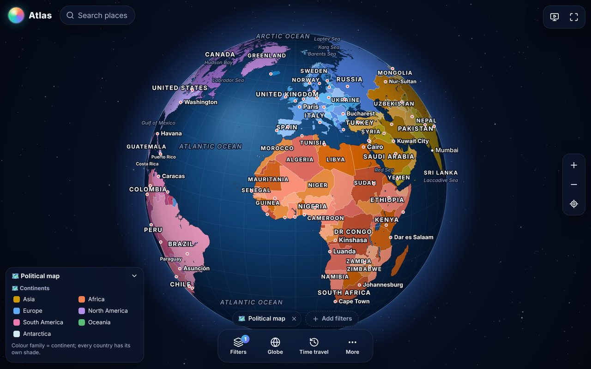
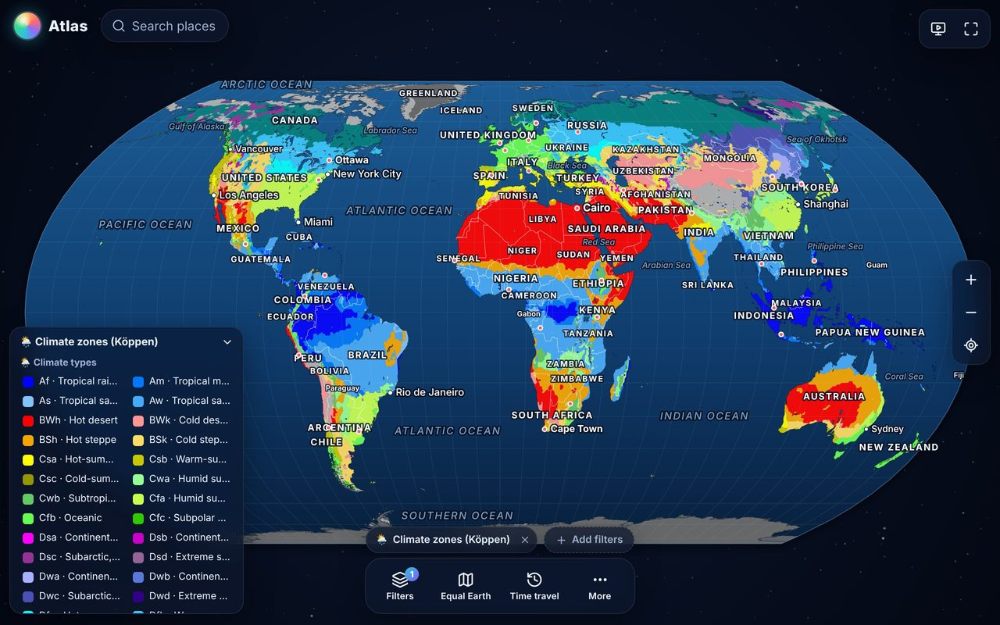
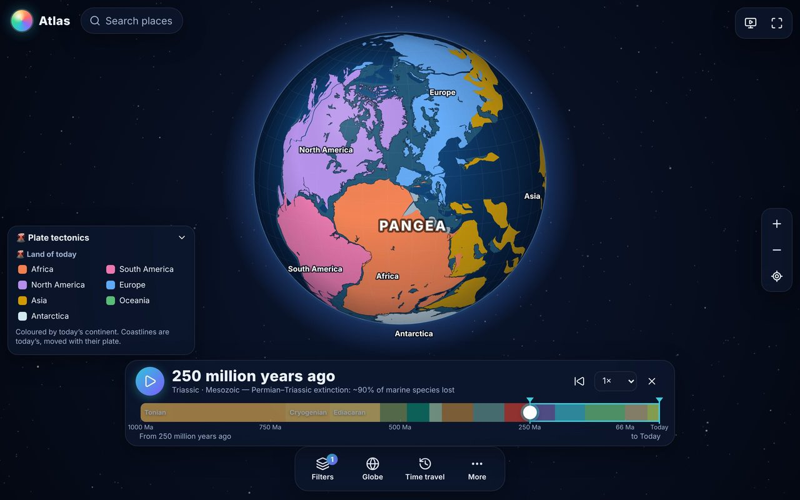

# Mundora

Mundora is a detailed, colourful, installable world globe (PWA). Stack any of ~140 map filters, morph between 14
projections, travel through 123,000 years of borders and a billion years of plate tectonics, and leave it
spinning full-screen as an ambient display. In English, Spanish (Latin America's, or Spain's words), Portuguese
(Brazil), French and German.

It was called Atlas Globe until v0.43.5, when the website took the apps' name and icon. The repository and the
address stay `globe`; the saved data keeps its `atlas-globe:` keys (so nobody's progress is lost), the code its
`window.atlas`, and the map style and theme called Atlas keep that word (a school atlas's look, not the app's name).
A backup made as Atlas Globe still opens.

- **App:** https://divaor.github.io/globe/ (GitHub Pages, deployed from `main`)
- **Install:** open it in Chrome, Edge or Safari, then "Install app" / "Add to Home Screen". Works offline after the first visit.

| | |
|---|---|
|  |  |
|  |  |
|  |  |
|  |  |

## What it does

- **Getting around (v0.41.1):** five tabs at the bottom: **Map** (filters, projection, map style and states, 3D
  terrain, search, and the tools: measuring, comparing, true size, Compare two filters, your own data, the 4K
  wallpaper), **Explore** (time travel, legacies of the past, space, the travel guide, art, nature, the Earth's inside,
  the deep, ambient mode), **Today** (in the middle), **Learn** (Master the world, Quiz, guided tours, On this day, your progress) and
  **Play** (map games, Fill the map, Put it on the map). Each opens its list above itself. The button top right holds
  Settings, your data on another device, sharing, saving a picture or a phone wallpaper, full screen (in a browser)
  and About. One bar above the map: a chip per filter, the top one carrying its legend's ⌃. Zoom and locate on the
  right. A first visit (not from a link) gets three short cards: how to move the globe and the language, Today, and
  where to start.
- **Fast, sturdy, accessible (v0.47.0):** the globe is on screen in under a second on a mid-range phone on 4G
  (it was six and a half): the rest of the app loads behind it. Text follows the phone's text size (iOS Dynamic Type
  too, and the map's names with it); every button has a 44-point target on a touch screen; text and buttons pass
  contrast in both themes; reduce motion (the phone's setting) stops flights, coasting, the screensaver's swaying and
  deep time's impacts. A screen reader hears what the map shows: the projection, the place in the middle, how close,
  the filters, the chosen country and, in time travel, the year; a move with the arrow keys or a new filter is read
  out. Offline, what needs an outside service says so at once instead of waiting; iNaturalist is asked at most 60
  times a minute, and Wikimedia's sites hear the app's name and version. **About and credits** lists all 75 sources
  in nine groups (maps, nature, the Earth, space, history, words, pictures, what is read live, the code), each with
  what it gives the app in plain words, who made it and its licence, in the app's language.
- **Languages (v0.42.0):** English, Spanish (Latin America's or Spain's), Portuguese (Brazil), French and German,
  like the phone unless one is picked in Settings or on the first visit's card. In Portuguese, French and German:
  every word of the app; the map's names (countries, states and provinces, cities, seas, rivers and mountains, World
  Heritage sites, animals and plants: Natural Earth's and Wikidata's names); every quiz, game and deck, Fill the map's
  clues and the guided tours; numbers, dates and ordinals as the language writes them; read aloud by the phone's own
  voices for the language. Stories, lives and the travel guide are still in English there, with a note saying so, and
  read aloud in English. Store listings for both stores are in `store/listings/` (six locales).
- **Political map (default):** every country has its own shade; the colour family shows its continent.
  Capitals, cities and sea names appear as you zoom. Tap a country for a card with its flag and facts.
- **Map style and states:** Map → Map style and states picks the look under every filter: Atlas (a colour per
  country), Map (a plain road-map look without the roads: one light land colour, a light sea, clear borders and more
  cities, their dots and names bigger the more people live there) or Satellite (NASA's Blue Marble, and Sentinel-2
  when you zoom in). States and provinces (the first-level divisions of every country, 4,596 of them) show from
  country zoom with thin dashed lines and their names, on by default and each with its switch; a tap says which one
  ("State: Texas") and Who was born here? names a place's state.
- **Today** (the bottom bar, between Globe and Time; a dot while something is left): every daily thing in one place.
  Your day ("5 of 17 done", the streak, Your progress, **Share my day**: all of today's results in one message), then
  the Daily challenge, Master the world's goal (with the cards to review), Fill the map's region of the day, Fill the
  states' country of the day, Put it on the map's puzzle of the day, the 12 map games' puzzles as tiles (ticked with today's score) and On this day. Each
  line opens its game; each game keeps its own "today" card in its own panel too.
- **Reminders** (🔔, optional, off until you turn one on): a **Remind me** switch in each daily game: the Daily
  challenge, Master the world (one per deck: capitals, flags, countries, state capitals, outlines, big cities,
  landmarks, rivers, mountains and seas), Fill the map's region of the day, Put it on
  the map's puzzle of the day and the Map games panel. The first switch asks the time (19:00 at first). **One
  reminder a day at most**, only if something you chose is not done yet, each day about a different one ("🏛️
  Capitals: 6 to review today · 🔥 keep your 12-day streak"); it makes no sound, replaces yesterday's and opens
  Today. Mundora has no server, so it uses what the device offers: where Mundora is installed on Android (Chrome), the
  phone wakes it in the background now and then and the notification comes **around** your time; elsewhere
  (iPhone, computers) the switch adds a **daily calendar reminder** at the exact time instead (an .ics file your
  calendar adds once; tapping it opens Today). Today shows your reminders and their time; Settings has one switch for
  all of them and the time.
- **The More menu:** Ambient mode, Your data, Settings and About sit at the top, with five groups that open in
  place, each row saying what is inside it in small type: **Explore** (Travel guide, Art and architecture, Nature,
  Inside the Earth, Into the deep), **Learn** (Master the world, Quiz, Guided tours, On this day), **Play** (Map games,
  Fill the map, Put it on the map; the Map games panel lists all 14 games), **Tools**
  (Measure distance, Compare countries, True size of countries, Compare two filters) and **Save and share** (Save
  image, the 4K and phone wallpapers, Share view). A row at the top of a group (or Escape) goes back, and the menu
  scrolls on a short screen.
- **Navigation:** drag with fling, pinch, mouse wheel, double-tap, keyboard. A card's or quiz's picture opens full
  screen to pinch and zoom; a picture that may be see-through (a PNG, SVG or GIF: drawings, diagrams, glyphs) sits on
  paper, so its dark lines show in the dark theme and full screen. A sound started from a card (an animal's call,
  a piece of music) goes on when the card closes, in a small player in the top bar whose ■ stops it.
- **Nature (Explore → Nature):** the animal finder, "Where can I see…?": any animal by its English, Spanish or Latin
  name. The 405 work offline; any other of GBIF's species is looked up live and its range is GBIF's live map of every
  sighting shared. For each, the best parks to see it (ranked by sightings), when to go (sightings by month, live from
  iNaturalist, worldwide or at a park) and Plan a trip (the nearest travel-guide city). What lives here?: tap the map
  or press Near me for the animals people have seen most within 50 km, with photos (live from iNaturalist), or offline
  those of the 405 that live there. The travel guide's See tab adds Wildlife nearby; the quizzes Where does it live?
  (tap where an animal lives) and Who lives here? (which of four animals lives in a place); Pin it adds an Animals pack;
  three tours (The Big Five safari, Animals of the Amazon, Life on the ice); the Naturalist badge (find 25 animals);
  a nature question in the daily challenge; and an Animals of the world playlist for ambient mode.
  Its Plants tab is the plant finder, "Where does it grow?": the 305 plants offline and any other plant on GBIF live,
  each with its best parks and botanical gardens, when it flowers (the sightings people marked in flower on
  iNaturalist, worldwide or near a park) and Plan a trip; What grows here? (the plants seen most within 50 km); the
  green filters; and What's on this month. The travel guide's Facts tab adds nature's calendar nearby; the quizzes
  Where does it grow? (tap where a plant grows wild) and When is it? (the best month for a spectacle); Pin it adds a
  Famous trees pack; two tours (Giants and ancients: the great trees; A year of blossoms); the Botanist badge (find 25
  plants); and a Green planet playlist for ambient mode.
- **Inside the Earth (Explore → Inside the Earth):** the globe cut open to scale, an eighth taken out, turning with the
  globe: the crust, the upper mantle, the transition zone, the lower mantle, the liquid outer core and the solid inner
  core, their names on the cut and the map's names kept off the opening. Each layer's facts (what it is made of, how
  hot and squeezed, how we know), a slider that peels the layers away down to the inner core, and Cut where I look.
  Dig down: tap anywhere for a column to the centre on a stretched scale: how thick the crust is there (CRUST1.0), the
  rocks under your feet (live from Macrostrat's geological map), 35 real things at their depths (the deepest mine, cave,
  borehole and dive, the Titanic, the Challenger Deep, the deepest earthquake…), the temperature, pressure and density
  wherever you touch it, and Dig through: where you would come out on the other side and how long the fall would take.
  Seismic waves: a quake's P and S waves crossing the Earth minute by minute, and the shadows the liquid core casts.
  Two quizzes, How deep? (which of two goes deeper) and Down to the core (put four in order, shallowest first), and
  two tours: Journey to the centre of the Earth (Verne's novel against the real Earth, the cut opening on the way down)
  and the Ring of Fire (ten stops, with earthquakes by depth under Tonga).
- **Into the deep (Explore → Into the deep):** Dive from here: tap the sea anywhere for a column from its surface down to
  11,000 m, the sea floor of that place drawn in (the deepest point of the cell, so a trench reads true): the zones
  (sunlit, twilight, midnight, the abyss, the trenches), the light, the temperature and the pressure wherever you
  touch it, the sea animals of that ocean and latitude at their depths (tap one for its story), the records (the
  deepest freedive and scuba dive, the Trieste, the Titanic, the Challenger Deep…), and what has been seen near there,
  live from OBIS. A dive below 6,000 m earns the Diver badge. The zones tab says what each depth is like. Two quizzes,
  Name the sea feature (a pin under the sea, four names) and Which ocean zone? (a sea animal, five zones), and How
  deep? now with sea animals and wrecks; two tours, Wonders of the deep and Famous shipwrecks; the Time travel story
  Into the deep: exploring the ocean floor; and an Into the deep playlist for ambient mode.
- **Deep time (Explore → Deep time, v0.45.0):** the Earth from its first days to today on one animated, interactive
  timeline, joined with the plate tectonics of Pangea to today. The continents move (the plate model back to a
  billion years ago, an impression before that), and the planet's look changes with time: a magma ocean, an orange
  haze before the air had oxygen, rusty bare land, Snowball Earths, ice caps that grow and shrink, green land once
  plants spread. 135 events happen where they happened (the great eruptions glow while they last, and the
  asteroid that ended the dinosaurs streaks in, flashes, sends shock rings round the globe and darkens the world),
  firsts pulse when their moment comes, and 321 past species appear at their fossil sites, moved with their
  continents, while they lived (tap one for its card with a picture, its size, diet and closest living relatives).
  Always on screen: how long ago, the eon, era, period and epoch in their official colours, the cosmic calendar (all
  of time since the Big Bang in one year), and the Earth's vital signs (oxygen, carbon dioxide, temperature, day
  length, the Sun's brightness, the Moon's distance, sea level, ice, the ozone layer) with a plain verdict: could you
  survive here? What lived then lists everything alive at that moment, in the sea, on land and in the air. Play the
  story: it flies through it all with 80 narrated moments, read aloud or timed to read. A true scale shows how
  little of the time is ours; Continents only gives the plain plate view. Also: the search finds species and
  events, Life through time stories link both ways, "Which came first?" in Learn, Today in deep time, three badges,
  and #deeptime= links.
  **From the Big Bang (v0.46.0):** a second chapter, the universe from its first instant to the Earth and the Moon,
  drawn as a scene: the point of light and inflation, the glowing fog of the first minutes with its quarks, protons
  and the first nuclei, the oldest light (an oval like the Planck map), the dark ages and the cosmic web of dark
  matter, the first stars and their supernovae, bubbles of reionisation, galaxies and an early quasar, cosmic noon,
  then the camera flies into the Milky Way (Gaia-Enceladus falls in; the place the Sun will form), the Sun's cloud
  collapses, the disc of dust makes the first solids, small worlds, Jupiter and Mars, and the young Earth is hit
  by Theia and gets its Moon. 25 events (tap them in the scene), 25 narrated moments with the cosmic calendar, and
  the universe's vital signs (age, temperature of space, size compared with today, what it is made of, light) from
  the Planck satellite's 2018 results. Chapters: From the Big Bang, The Earth, or Big Bang to today, both joined in
  one story; the true scale shows the Earth forming two-thirds of the way along. #deeptime=t380000 links go to a
  time after the Big Bang.
  **One play button (v0.46.1):** the clapperboard turns Narrated on, and the play button then tells the story
  (and pauses it); with Narrated off it runs through the years. Both go at the pace of what happens: quickly across
  quiet stretches and slowly through events and the scene's moments (the fog clearing, the flight into the Milky
  Way, Theia and the Moon gathering, which used to flash by), at 0.25× to 4× (the speed is on phones too). The
  narration reads each moment in one go, without a pause or a cut word at every full stop.
- **Legacies of the past (Explore → Legacies of the past, v0.44.0):** what past civilizations gave the world that we
  still use, and how connected that makes us: 20 civilizations (the Sumerians, Babylonians and Assyrians,
  Egyptians, Phoenicians, Greeks, Romans, Persians, the Islamic Golden Age, Ancient India and China, the Maya, Mexica,
  Incas, Taíno, Norse, Celts, Polynesians, the First Peoples of North America, the West African kingdoms and Aksum)
  and 628 legacies in 14 subjects: words and names, writing, numbers, time and calendars, science, buildings,
  tools, food, money, law, ideas, the arts, games and daily life. Each civilization has its homeland at its height on
  the map, its intro, its heirs today, a link to its time-travel story and, first, the words and names it gave us
  ("They gave us words like paper, ebony and oasis; names like Susan"), by kind (words, people's names, place names,
  days and months, stars and planets), each opening the legacy it comes from; each legacy says how they gave it
  (invented, developed, spread, named, tamed or kept alive, with what it was built on and whether it is debated), its
  story in more detail, its words (Nahuatl *tomatl*, Quechua *ch'arki*, Taíno *hamaca*…), the line of its journey to
  today step by step, and who uses it now: the countries in colour, darker where it is strongest. A country (its
  card's "Borrowed from the past", or a tap on the map) shows what it borrowed from each civilization, with a line from
  each, thicker for more, and the words it took from each. Search finds a legacy by its name or its words; a people story links to what its
  civilization gave us; "Who gave us this?" (Learn → Quiz, and some days the Daily challenge) asks which civilization
  gave a thing; the legacy of the day is in Today; and two badges, Heir of the ages (40 legacies) and All our
  ancestors (one from each of 20 civilizations). Links: `#legacy=egyptians`, `#legacy=mexica/tomato-words`,
  `#legacy=@MEX`. Data: `scripts/data/legacies/` (README there).
- **Search:** countries, cities, states and provinces, coordinates ("40.4, -3.7"), and what the filters show: the
  people of Who was born here?, museums, masterpieces and their artists, buildings and their architects, World
  Heritage sites, inventions and your own places. The filters that are on come first; a filter that is off is searched
  too, and choosing its result turns it on. Names match in any word order, by the start of each word and with a typo
  or two ("rafa nadal", "Nadal Rafael", "rafael nadl"). A result takes you to its dot: close enough that it stands apart
  from its neighbours, ringed, with its card open. With a filter whose legend lists categories on, its entries are
  found too ("Portuguese" with Languages highlights its countries). An empty box shows your recent searches.
- **14 projections, smooth morph:** Globe, Plate Carrée, Mercator, Miller, Robinson, Winkel Tripel, Equal Earth,
  Natural Earth, Mollweide, Gall–Peters, Eckert IV, azimuthal equidistant, Lambert azimuthal, stereographic.
  Every filter (vector and imagery) works in every projection.
- **Filter stack:** turn on several filters, set opacity and order; each has a legend (tap an entry to highlight
  its countries) and values in the country card. Filters include:
  - Political: time zones with live clocks, alliances (EU, NATO, G20, BRICS…), government, independence…
  - People: population, density glow, life expectancy, median age, languages (main / family / branch), writing
    systems (the script of each country's main language, with a letter of each), religion…
  - Climate & weather: Köppen climate zones, temperature, rainfall, sea temperature, animated winds.
  - Landforms & water: mountain ranges, deserts, plateaus, peaks, rivers and lakes, shaded relief, elevation.
  - Flora & fauna: vegetation zones, forest cover, animal realms with the Wallace Line, 60 iconic animals, great
    migrations through the year (31 journeys by land, sea and air: where each traveller is in every month, with the
    year's key moments), biodiversity hotspots, national animals and plants.
  - Animals of the world: 405 animals covering the globe where they live (379 today and 26 lost since 1500), from
    sightings shared on GBIF. Zoomed out, each part of the world shows its best-known animal that its neighbours
    don't; zoom in for more, with their names. Show all or one group (mammals, birds, reptiles and amphibians, fish
    and sea life, insects and other small creatures), only the threatened (ringed by Red List category) or the Gone
    (the dodo, the thylacine, the passenger pigeon… where they once lived). An animal's card has its picture and call,
    its group and family, its Red List status, size and lifespan where Wikidata has them, the countries it lives in,
    and Show where it lives (its squares, darker where more people saw it, its best parks as numbered stars), Best
    places to see it, Its relatives, and its step of the Lost and saved story.
  - Wildlife parks (2,100 national parks and nature reserves, each with the animals it is one of the best places to
    see) and Zoos and aquariums (1,300).
  - Plants of the world: 305 plants where they grow wild (107 trees, 67 flowers, 45 cacti and succulents, 43
    carnivorous and strange plants, and 43 food plants in their wild homes), from sightings shared on GBIF, as a carpet
    like the animals'. A plant's card has its picture, group and family, Red List status, height and lifespan, the
    countries it grows wild in, when it flowers (live from iNaturalist), and Show where it grows (in green, with its
    best parks and gardens as numbered stars), Best places to see it, Its relatives and, for a crop's wild form, where
    it was first grown.
  - Famous trees (the record holders, checked by hand: the tallest, Hyperion, and the oldest, Methuselah, shown at
    their park because their places are kept secret; and Wikidata's remarkable trees) and Botanical gardens (1,300
    gardens and arboretums, each with the plants that grow wild around it).
  - Ecoregions: RESOLVE's 846 ecoregions coloured by biome, each in its own colour, or by how much of it is protected;
    a tap gives its biome, realm, area and protection and the plants and animals of ours that live in it. Highlight
    lights up one biome (the deserts, the rainforests) and names only its ecoregions, the others dimmed.
  - The breathing planet: NASA's twelve monthly pictures of how green the land is (MODIS NDVI, 2024), playing as a year
    or one month at a time: spring sweeping north in April and May, and south in October.
  - Nature's calendar: 150 spectacles of plants and animals (cherry blossom, flowering deserts, autumn forests, the
    great herds, the turtles' nesting nights…) by month, the best month marked; What's on this month lists them, the
    nearest to the middle of the map first.
  - Where our food first grew: 57 crops where people first grew them, when, and how they spread around the world
    (arrows to where and when they arrived), each linked to its plant and to its step of the Food stories.
  - Earth science: tectonic plates by boundary type, with arrows for how each part moves today (NNR-MORVEL56; a tap
    says how fast a place moves and which way: Madrid about 2.3 cm a year to the north-east); the Smithsonian's
    1,214 volcanoes of the last 10,000 years by their last eruption (all, since 1900 or the famous ones; a tap gives
    their type and last eruption; search finds them); animated ocean currents.
  - The oceans: the sea floor by depth zone (a tap gives the depth there); Drain the oceans, a slider from +70 m
    (all the ice melted, the big coastal cities under water, heights only, not a forecast) down to −11,000 m (the
    Ice Age land bridges at −120 m, then the shelves, the ridges and at last the trenches); undersea mountains and
    trenches (GEBCO's 5,400 names, the famous ones first, with how a feature got its name); hydrothermal vents;
    shipwrecks (66 famous ones with their stories and about 1,000 more, by era, search, the deepest); the living
    ocean (plankton and sea ice month by month, 2024); mangroves and kelp forests; the ocean garbage patches.
  - Inside the Earth's filters: earthquakes by depth (the 26,650 of magnitude 5.5 or more since 1970, shallow to
    700 km, with Draw a slice: two taps across a trench for the quakes within 150 km seen from the side, a sinking
    plate traced in them); mantle hotspots (Hawaii, Yellowstone, Iceland, Réunion and five more, with their island
    chains dated in millions of years); where a compass points (needles from NOAA's World Magnetic Model 2025 and the
    magnetic poles' tracks since 1590; a tap gives the declination there); underground wonders (56 caves, geysers and
    hot springs, impact craters and mines, each with its facts, found by search).
  - Economy & energy: GDP, income groups, top producers of 21 resources (oil, lithium, cobalt…), CO₂, renewables…
  - Culture & fun: flags on the map, national colours, driving side, calling codes, Olympic medals and more.
  - World Heritage: every site on UNESCO's World Heritage List after the July 2026 session (1,273, plus the 3
    removed), by category or by year listed, with the 58 in danger ringed in red. "Watch the list grow" plays the
    years from the first 12 sites of 1978, with play and pause, a slider to any year and one for the speed (half a
    year to eight years a second); a tap on a site opens its picture, Wikipedia's summary, its year,
    criteria and UNESCO's page, and a country's card counts its sites.
  - Where things were invented: the inventions of the Inventions stories where they were made, by age and field.
  - Who was born here?: where 12,215 of the world's best-known people were born (or died), from Wikidata: a dot is a
    place, in the colour of its best-known person's field, bigger for more people; by field (leaders, science,
    writers, art, music, film and stage, sport, thought, explorers) and by when they were born. A tap lists the
    place's people; a person's card has their portrait, years, birth and death places, Wikipedia, their life in
    Lives on the map when there is one, and the city's guide. Living people appear by birthplace only.
  - Close up, the dots of these filters that overlap (two museums in one building, a city's birthplaces) move
    apart, each with a thin line to its true place, so every one can be tapped; the layout holds still while
    you drag the map.
  - Imagery: NASA Blue Marble, yesterday's real satellite view (NASA GIBS), shaded relief, ETOPO.
- **Terrain in detail:** zoomed in, Shaded relief and Elevation are drawn by the GPU from terrain heights
  (Terrain Tiles on AWS: SRTM, GMTED, ETOPO1 and national data), and Satellite from Sentinel-2 cloudless 2016
  (about 10 m), for just the area on screen, sharper the closer you go; the zoom goes about four levels deeper. Tiles
  are kept in memory up to a cap and freed as you move on. In Settings: detail on or off, only on Wi-Fi (where the
  browser says how it is connected), and how much was downloaded. **Save an area for offline use** from the
  filter's legend: choose the detail, see the size first, and find the saved areas in Settings with their size and
  a delete button. **3D terrain** (the mountain button by the zoom buttons): the area on screen as a landscape on
  the curved Earth, draped with satellite, relief or elevation colours, with a slider that raises the mountains;
  drag to turn, pinch to zoom.
  - Live: day and night with city lights, earthquakes (USGS), weather now (Open-Meteo), the ISS.
- **Beyond Earth** (the Space button): the globe becomes another world with its real map: the Moon, Mercury,
  Venus, Mars, Ceres, Vesta, Jupiter and Io, Europa, Ganymede and Callisto, Saturn, Titan and Enceladus, Uranus,
  Neptune and Triton, Pluto and Charon (NASA and USGS mosaics; Solar System Scope for the giant planets). Every
  world shows the IAU names of its places, sized as you zoom; tap one for its card: what it is, its size, and whom
  or what it is named after, in English and Spanish. Every landing on another world is marked, with the rovers'
  and moonwalkers' routes and a card for each mission. The Moon and Mars have a heights map, sharp tiles from NASA's
  Solar System Treks as you zoom in, and the 3D view; other worlds sharpen too where Trek has them. **The solar
  system** shows the Sun, the planets, the dwarf planets and Halley's Comet on their real orbits on any date from
  3000 BC to AD 3000, playing at a day to ten years a second; tap a world for its facts and visit it. Shared links
  open a world (`#world=mars`).
- **Stars, the galaxy and the elements:** behind the globe, the real stars and the Milky Way, lined up for this
  moment and the side of the Earth you face. **The night sky** from any place and time, or from where you are: 5,000
  stars in their colours, the 88 constellations with their figures, borders and names, the Milky Way (ESO's
  panorama), the Sun, the Moon with its phase and the planets, daylight and twilight; drag to look around, play the
  hours, switch to the northern or southern sky, and tap a star, constellation, nebula, cluster, galaxy or planet for
  its card (152 deep-sky objects, the brightest stars, every constellation's story). **Our galaxy**: one zoom from
  the nearest stars through our neighbourhood and the Milky Way seen from above to Andromeda and the Local Group.
  **Where the elements come from**: the periodic table filled with the share of each element made by the Big Bang,
  cosmic rays, dying small stars, exploding massive stars, exploding white dwarfs and merging neutron stars (after
  J. A. Johnson, 2019); an element's card shows where that happens in the sky (with a button back to the element), who mines it today (the resources
  filter, now with 54 mined commodities) and where it was discovered. Search finds constellations, stars, sky objects
  and elements; shared links open them (`#sky=Ori`, `#galaxy=M42`, `#element=Au`).
- **Your data:** a CSV (or a table pasted from a spreadsheet) becomes a filter with a legend, kept on your device
  and nowhere else. Rows can be countries (names in English or Spanish, the usual aliases, or ISO codes), regions
  inside a country (4,596 states, provinces and departments) or places with a latitude and longitude. Numbers are
  read with a decimal point or a decimal comma; a row per place and year (Our World in Data) or a column per year
  (World Bank) gives a year picker and "Play the years"; world and regional totals are set aside. Countries and
  regions are coloured by a number (nine palettes; automatic, even, logarithmic or rank scales) or by categories;
  points are sized by a number and coloured by a category, each with its card. Number columns by country can be
  compared with any country fact. Four samples to try: life expectancy since 1950, Latin America's biggest cities,
  World Heritage sites by Mexican state, and a list of travels.
- **Compare two filters:** any two country facts at once. Two numbers make a two-colour map (each in thirds,
  3 × 3 squares to tap) and a scatter chart linked to the globe both ways (tap a dot to fly to its country, tap
  a square to light its countries on the chart), with Spearman's ρ and Pearson's r in plain words, the
  countries furthest from the trend, and a reminder that correlation is not causation. A total against another
  (Olympic medals and population, oil and area…) can be divided ("per million people"). A category against a
  number gives a dot plot with medians; two categories give a cross table with Cramér's V. Start from the
  Filters panel, the More menu, or "Compare with…" in any country-facts filter's legend.
- **Time travel:** borders through time (54 maps, 123,000 BC → 2010) with start/end, play, speed and
  "What changed"; Deep time, which takes in Pangea to today (Merdith et al. 2021 plate model, 1,000 Ma → today), with
  the geological time scale.
  Researched stories play step by step on the map, with territory, routes, markers and a card with a Wikipedia
  picture for every person, work, place, dish or building:
  - Wars and conquests: 26 conflicts, from Alexander and Rome to the World Wars, with battles and aftermath.
  - Eras and ideas: 11 stories, from classical Athens and the Islamic Golden Age to the Renaissance, the
    Enlightenment, the Industrial Revolution, modern art, rights and freedom, the Space Age and computing.
  - Food through time: 10 stories (the dawn of farming, maize, wheat, rice, the potato, the Columbian Exchange,
    spices, sugar, coffee, tea and chocolate) and 248 dishes of the world, with where and when they were born.
  - Great structures: about 220 structures from Göbekli Tepe to the Burj Khalifa (why, how and by whom), the
    Seven Wonders, the race to the sky, and bridges, canals and dams.
  - Peoples and civilizations: 18 stories and 936 items. The human story from Toumaï, 7 million years ago, to
    Homo erectus, the Neanderthals and Denisovans, Out of Africa, the peopling of the Americas and the
    Austronesian voyages; eleven civilizations (Mesopotamia, Egypt, the Indus, Persia, Kush and Aksum, ancient
    China, the Khmer, Ghana-Mali-Songhai, Great Zimbabwe and the Swahili coast, the Olmecs and Maya, the Andes);
    and 126 civilizations rising and falling in a time tour from 3300 BC to 1600. Dates before 10,000 BC read
    "N years ago".
  - Life through time: 13 stories, 198 steps and 539 fossils, sites, species and finders. A step older than 5
    million years is drawn on the continents of its age (the Merdith et al. 2021 plate model): every fossil moves
    with its plate, the continents drift from one step's age to the next, a tap on old land says what it is
    today, and a fossil's card gives the latitude it lay at. The stories run from the first life and the
    Cambrian explosion, through life coming ashore, the five mass extinctions, the dinosaurs, sea reptiles and
    pterosaurs, the age of mammals and the Ice Age giants, to the fossil hunters, where animals were tamed,
    species lost and saved, and ranges then and now. A time tour in 23 chapters places a catalogue of 136
    famous fossils on the drifting continents, from 3.7 billion years ago to today.
  - Games of the world: 11 stories, 130 steps and 431 items. Every Summer and Winter Olympics (1896–2026) and
    every men's and women's FIFA World Cup (1930–2026) is a step: each country is coloured by how it took part
    (host, champion, medals, took part, boycotted, banned or not invited), arcs fly from every team to the host
    city, and the host's card holds its medal table or last four. A tap on a country tells how its team did, or
    why it stayed away (Kazakhstan in 1980: part of the Soviet Union's team). Also the Women's World Cup from the
    1921 ban, a century of boycotts and bans, the Tour de France and the marathon, from Marathon to the first
    race under two hours.
  - Journeys and trade routes: 14 stories, 216 steps and 627 items. Each step draws the next stretch of the
    journey, with the traveller (a ship, a caravan, a sledge) moving along it, and the way already travelled
    stays on the map as a faded trail; sea routes are dashed and kept at sea. The journeys of Xuanzang, Marco
    Polo, Ibn Battuta, Zheng He, Magellan and Elcano, Cook, Lewis and Clark, the Arctic explorers and the race to
    the South Pole; the Silk Road, the incense and spice routes, gold and salt across the Sahara, silver and the
    Manila galleons, and the Atlantic slave trade, told plainly with the Slave Voyages numbers and the
    resistance. The peoples met are named, with the guides and interpreters the journeys depended on.
  - Religions and philosophies: 10 stories, 159 steps and 482 items. Where the faiths and schools of thought
    began and how they spread, told plainly and with respect: what believers hold is given as their belief
    ("Muslims believe…", "by tradition"), and debated dates are given as debated. Hinduism, Judaism, Buddhism,
    the first philosophers of Greece, India and China, Confucius, the Dao and the kami, Christianity, Islam,
    Sikhism, and the African faiths carried to the Americas; and a time tour of the world's faiths from Göbekli
    Tepe to today, with today's numbers of believers from the Pew Research Center (2020).
  - Writing and languages: 9 stories, 139 steps and 357 items. The separate inventions of writing in
    Mesopotamia, Egypt, China and Mesoamerica, the alphabet's journey from Egyptian pictures to Unicode, the
    characters of East Asia, scripts made by one person (Hangul, Cherokee, N'Ko…), the code breakers and the
    scripts still unread, the world's language families, the Indo-European languages, the Bantu expansion, and
    Spanish from Latin to the world. 161 cards show a sample in its own script (cuneiform, hieroglyphs,
    Phoenician, Brahmi, Mongolian in columns…), drawn with small font files that are fetched only for the
    letters on screen.
  - Plagues and cures: 11 stories, 177 steps and 498 items. How epidemics spread and how people learned to
    fight them, told plainly: death tolls are given as ranges with their sources, and the people wrongly
    blamed are named as wrongly blamed. The Black Death month by month, plague through the ages, smallpox from
    variolation to eradication, cholera and John Snow, germs and antibiotics, malaria, yellow fever and the
    mosquito, the 1918 flu, HIV and AIDS, COVID-19 (with the debate over its origin as it stands) and vaccines
    for all; and a time tour of medicine from Egypt's papyri to mRNA vaccines, with 103 healers, books,
    hospitals and discoveries.
  - Natural disasters: 9 stories, 144 steps and 352 items. Eruptions, earthquakes, tsunamis, floods and
    storms, and how far their effects reached. Some go hour by hour, in the local time of each place
    ("1 November 1755, 09:40"): Vesuvius in AD 79, the Lisbon earthquake and its tsunami across the Atlantic,
    Krakatoa, the Indian Ocean tsunami of 2004 and the tsunamis that crossed the Pacific, drawn as they
    spread. Also Tambora and the year without a summer, floods, storms and droughts since 1887, and time
    tours of volcanoes and of earthquakes, with today's plate boundaries.
  - Music and dance: 7 stories, 112 steps and 383 items, 90 of them with a short clip of a free recording on
    Wikimedia Commons. Tap play on a card, or turn on ♪ in the story bar to hear each step's clip while the map
    moves, in stories and in tours. A time tour from the Ice Age flutes of the Swabian Jura to streaming, with a
    catalogue of 93 instruments, styles, pieces and musicians; classical music from Bach's Leipzig to the Rite of
    Spring; instruments of the world, each with its own sound; jazz, blues and soul, from Congo Square to
    International Jazz Day; rock, pop and hip hop, from Bombay's film songs to Afrobeats; Latin rhythms; and dances
    of the world, from the Natya Shastra to breaking at the Paris Olympics. Music still under copyright has no clip.
  - Books and writers: 7 stories, 116 steps and 319 items, 105 of them with a famous line in its own language and
    script (Homer's Greek, Murasaki's Japanese, Ferdowsi's Persian…), with how it reads and what it means. A time
    tour from Gilgamesh to e-books with a catalogue of 96 books, writers and libraries; epics of the world; tales
    that travel, from the Panchatantra to Pinocchio; novels at the places where they happen; poetry of the world;
    literature in Spanish, from the jarchas to today; and the story of the book, from clay tablets to screens.
    Long quotes come only from texts in the public domain; books still under copyright get one short line.
  - Art of the world: 7 stories, 113 steps and 341 items. Each work sits where it was made, its card shows the work
    itself (to open full screen and zoom) and where it is now. A time tour from the ochre of Blombos Cave to street
    art with a catalogue of 109 works, artists and museums; cave and rock art; the ancient world; Renaissance and
    Baroque painting; art of Asia; Impressionism to modern art; and works taken in war and by empires, and
    returned, with each side's case. Works still under copyright have no picture.
  - Inventions: 10 stories, 163 steps and 539 items. Where things were invented and how they travelled: a time
    tour from the stone tools of Lomekwi, 3.3 million years ago, to generative AI, with a catalogue of 113
    inventions; China's four great inventions and their journeys west; keeping time, from shadow clocks to the end
    of the leap second; lenses, from Ibn al-Haytham to the Webb telescope; flight, from kites to drones; messages,
    from Inca runners to undersea cables; power, from water wheels to solar panels; everyday inventions; who really
    invented it, with the disputed firsts and forgotten inventors; and inventions from Latin America.
  - World Heritage: 4 stories, 61 steps and 170 items. How World Heritage began with the rescue of Abu Simbel;
    sites destroyed and rebuilt, from Warsaw to Mosul; saving nature's wonders; and Latin America's history told
    through its World Heritage. Any story card for a World Heritage site says when it was listed and whether it is
    in danger, with a link to UNESCO.
  - Space exploration: 5 stories, 90 steps and 337 items, on the Earth and on the worlds they reached (a step on
    the Moon or Mars turns the globe into that world, with its landings and rover drives). Astronomy through
    history, from Nabta Playa and Babylon's diaries to Mauna Kea and the Atacama; the space race, from the V-2 to
    Apollo–Soyuz; footprints on the Moon, every landing from Luna 2 to Artemis II; robots to the planets, from
    Mariner 2 to Juno; and wheels on Mars, from Mars 3 to where Curiosity and Perseverance are now.
  - Lives on the map: 168 lives of scientists, writers, artists, composers from Monteverdi to Bowie, leaders, campaigners
    and athletes, from Hatshepsut and Confucius to Kobe Bryant, followed place by place: where they were born, studied, worked,
    made their great works, were exiled or imprisoned, and died, each step with their age, the route from the last
    place (by sea, by air, on foot) and the borders of that year. Only the places that mattered, not every stop of
    a tour; where historians are not sure of a place or a date the step says so. The last step shows the places
    you can visit today (birth houses, museums, graves). Twelve pairs of lives side by side (Chopin and Liszt, Pelé and
    Maradona, Darwin and Lincoln, born the same day…) in two colours, with a handshake where their paths crossed. A city's guide has a People tab (the
    lives that pass through it, who was born and who died there), search finds every life, and On this day has
    their births and deaths. Lives are written only for people who have died.
  - Browse and search every item of a story or a whole collection; shared links open a story at its step.
- **Explore:** measure distances (great circles, flight time), compare two countries, "true size" of countries.
- **Learn & play:** quizzes (find the country, flags, capitals, states and provinces of 48 countries, where in
  the world, when was it built or made, dishes of the world, which era, which civilization, which geologic
  period, who won, guess the link between two country facts, which journey, which faith, which script, which
  language family, which epidemic, which disaster, what are you hearing, which book is it from, who made it, which World Heritage site, who invented it,
  which world is this, who landed here, which constellation, where was this element made, which country in between,
  how deep?, down to the core, name the sea feature, which ocean zone?),
  each ending with every answer and its picture; two games of time:
  Put them in order (four things from the stories, oldest first, then shown in order with their dates and pins on the
  map) and Time detective (a map of old borders with no names: which of four years is it from?); a daily challenge
  of eight questions, the same for everyone each day, with a streak and a result to share (every quiz puts the
  filters away while it is on, so their names give nothing away, and brings them back after); your progress, with right
  answers, day streaks and badges for six subjects, the daily challenge and the tours (kept in this browser);
  guided tours (our planet, twenty cities through time, from Athens, Baghdad and Xi'an to Buenos Aires, Rio de
  Janeiro and Cusco, history and culture, Out of Africa, capitals of the ancient world, the dinosaur trail, the five
  mass extinctions, Olympic cities, World Cup finals, the Winter Games, great races, along the Silk Road, around
  the world under sail, to the ends of the Earth, gold, silver and spices, holy places, pilgrims' ways, writing
  is born, code breakers, the story of the alphabet, languages of the world, pandemics that changed history,
  medicine's great discoveries, tsunamis across the oceans, the year without a summer, disasters of the Ring of Fire, first lines,
  great libraries, masterpieces and where they are, sounds of the world, cities of music, Latin America's World
  Heritage, nature's wonders, lost and rebuilt, China's great inventions, from the telegraph to the Web, invented in
  Latin America, a grand tour of the solar system, footprints on the Moon, born in the stars, a night under the
  Southern sky, journey to the centre of the Earth, wonders of the deep, famous shipwrecks: each plays by itself from its first stop and stops at its last, where ↺ plays it again); "On this
  day", any day of the year: what the Time travel stories tell of it, each opening its
  step (the story's X comes back to the day), and Wikipedia's selection of events, linked to the story that tells
  the same event. A story opened from a card ("Open its story") or a list starts paused at its step with all its
  controls; its X goes back to the map and filters there were. While a tour, a story or the years of a timeline
  play by themselves (or are read aloud), the screen is kept on, where the browser can (the Screen Wake Lock).
- **Master the world** (Learn → Master the world, or the Quiz panel): every capital, flag and country
  learned for good, a little each day. Three decks (the 193 UN members plus Vatican City and Palestine; territories
  such as Greenland or Hong Kong as a setting) and three ways to play: **Learn** (spaced repetition: the countries due
  today first, then up to five new ones; one you miss comes back three questions later, one you get right comes back
  the next day, then in 3 days, then about 2.5 times as long each time; right on 3 different days and it is mastered),
  **Run** (three hearts, a combo, a power-up every 10 in a row: fifty-fifty, a heart or a peek) and **Marathon** (the
  whole deck; a miss starts it over, and a country right 10 times running is skipped). Each question is on the globe:
  the country outlined and the rest dimmed, four of its cities as dots with no names (picked from a list, then tapped
  once known, then typed if you like, accents and small typos forgiven); after the answer the names appear, the
  capital gets a gold star, and the card says which of the four is biggest. Where a country has two seats of
  government the official capital is the answer and the other is explained (Bolivia: Sucre and La Paz), never
  offered as a wrong one. Flags are picked among four of the continent, then among their look-alikes; miss one for
  its look-alike and the two are shown side by side with how to tell them apart (Romania and Chad, Indonesia and
  Monaco, Ireland and Côte d'Ivoire…). Countries are picked among their neighbours, then tapped on a map with no names
  (no state names either). The card moves on by itself (fast, normal or slow), waits longer after a miss, and stays
  while you press and hold it; the keys 1 to 4 pick and Enter goes on. New countries come in the order you choose
  (balanced, best known first, most people first, by continent, A to Z or random), from the world or one continent.
  A daily goal of 20 answers keeps a streak that also keeps the Daily challenge's, which in turn adds one capital of
  yours to review. Progress by level and continent, badges (each continent's capitals, every capital, every look-alike
  flag told apart, every country among its neighbours, a marathon without a mistake, a week and a month of daily
  goals, 20 comebacks), a picture to share, sounds and buzz (a setting), and it works offline. **Your world**, a
  filter (Fun), paints each country by how well you know it: learning, known, mastered.
  A fourth deck, **State capitals** (📍 States), asks the capitals of the 289 states, provinces and regions of the
  twelve countries of Fill the states, one country at a time or all twelve: the state outlined among its country's
  states with its capital and up to three other cities as dots ("What is the capital of Biobío?"), later the other
  way round among four nearby states ("Valparaíso is the capital of…"); a state that is a city of its own (Mexico
  City, Berlin, Washington) has nothing to ask. Its own order ("Country by country"), progress by country, a 🔔, a
  badge for each country's capitals and one for all twelve; Fill the states' capitals count in it too.
  **Four more decks** (v0.39.0), on the same engine (spaced repetition, Learn, Run, Marathon, the daily goal, a 🔔
  each, a badge for each deck mastered), by continent:
  - **Outlines** (🖼️): a country's shape alone in the card ("Which country has this shape?"), picked among its
    neighbours; once known, found on a map with no names; then typed. Your world paints it too.
  - **Big cities** (🏙️): the 250 best-known cities (a share for each continent), a gold dot on a map with no names
    ("Which city is this?"), picked among its nearest big cities; then "Tap Mexico City" among their dots; then typed.
    The answer says its country, whether it is the capital and its people.
  - **Landmarks** (🏰): 300 World Heritage sites, each with its picture and name: in which country? Picked among its
    country's neighbours, then tapped on the map, then typed; the answer says when it was listed, and the picture's
    author and licence (read from Wikimedia Commons). Sites in more than two countries, or named after their own
    country (Great Zimbabwe), are left out.
  - **Rivers, mountains and seas** (🏞️): 51 rivers, 26 lakes, 31 ranges, 17 deserts, 30 peaks and 47 oceans, seas,
    gulfs, bays, straits and channels, drawn on the map in gold ("Which river is this?"), picked among the nearest of
    their kind; then "Tap “Danube”" among them in white; then typed (in either language, "Danubio" for "Río Danubio");
    the seas' names are hidden while it plays.
  - **Hard mode** (v0.39.1), a switch in Big cities and Landmarks: every city of a million people or more (553, the
    250 among them, each picked among its nearest of them all) and every World Heritage site with a picture (1,112).
    The cards are the same (what you know stays known); a badge for each hard deck mastered.
- **Fill the map** (Play → Fill the map): a world map coloured in country by country. Fill it with
  **countries** ("Tap Bolivia"), **capitals** ("Tap the country whose capital is Sucre"), **flags**, the **most people
  first** or the **largest first** (the biggest country left each time, so the map fills in order), **clues** (a ladder
  from hard to easy, one more after each miss: a national animal, dish or export, then a famous person or the highest
  point, then a World Heritage site; themes Nature, Culture, People or all) or **languages** (any country that speaks
  it is right). Pick where: the whole world, a continent or one of its 22 regions. Each country found is painted in its
  own colour with its name: ★★★ at the first try, ★★ the second, ★ the third; a wrong tap says which country it was
  and brings a hint (its neighbours, then a circle where it is), and after three misses it is shown in orange. One map
  per category is kept (start one over when you like); a full region offers the nearest one not yet full and the
  countries shown to try again. Tiny countries get a ring to tap. Every answer counts toward Master the world's daily
  goal, and countries, capitals and flags in its decks too. A **region of the day**, the same for everyone, is in the
  Map games panel; badges for a continent, a perfect continent, the world and every map; a picture of your map to share.
- **Fill the states** (Fill the map → **States**): Fill the map inside one country, its states, provinces or regions.
  All 48 countries of the States and provinces quiz by **name**; the twelve with their states' facts (Mexico, the United
  States, Brazil, Argentina, Colombia, Chile, Peru, Spain, Canada, Australia, Germany, India) also by **capital** ("Tap
  the state whose capital is Guanajuato") and **biggest first** (people, area). The answer says the capital, and the
  biggest city when it is another ("🏛️ Toluca · Ecatepec is the biggest"). A miss says which state it was and where in
  the country the one asked is ("It is in the north-west of Mexico"), then a circle; the map's own state names are
  hidden while playing. A map per country and category, ★ stars, Next country, badges (a country filled, its capitals, a
  perfect country, all twelve by capital), and a **country of the day** in Today (with its 🔔 reminder). The facts:
  each state's capital, area and people from Wikidata (CC0) by its ISO 3166-2 code, its other cities from GeoNames
  (CC BY 4.0), checked by `scripts/data/states/build-states.mjs --check` (in `npm run check:data`). A city's people
  are Wikidata's: the item GeoNames points to, else (v0.38.1) the municipality of the same name it lies in (Londrina,
  Joinville), else a place of its name within 10 km, each only within three times GeoNames' own count (a district of
  the same name is not the town); a city with no sure count has 0 in the file, so no game says which is biggest.
- **Put it on the map** (Play → Put it on the map): a Wordle-style puzzle. Six things from a country
  or a region (a river, a lake, a mountain range, a desert, a peak or volcano, a city, a heritage site or famous
  building, a national park) to put where they are: tap a name, then one of the grey places of its kind (the rivers
  there as grey lines, the ranges as grey areas, the cities as dots...); on a computer a name can also be dragged onto
  the map. **Check**: each one turns green when right, or yellow to red by how far off it is, measured against the size
  of the country (300 km is far in Belgium and close in Russia). The greens stay, the others move; five checks. Mixes:
  Everything, Nature, Cities or Built. 114 countries have enough for a fair puzzle (three or more places of each kind
  asked); the others are played in their region or continent. A **puzzle of the day**, the same for everyone (a
  country one day, a region the next), is in the Map games panel and is shared as a grid of coloured squares. On a
  phone the card shrinks to the name being placed, so the map has room. Badges for a puzzle solved, all six at the
  first check, and a week of puzzles of the day.
- **Map games** (Play → Map games): twelve games played on the map, each with a new puzzle every day that is the
  same for everyone (the panel's Today list), a best score and badges. The map, its labels and filters come back as
  they were when a game ends.
  - **Pin it:** drop a pin where a place is, five rounds. A pin on the spot scores 5,000; 1,500 km off scores about
    1,840. Seven packs of places from the app's own data: capitals, World Heritage sites, great structures, battles,
    dishes, inventions and museums, or all of them mixed. Hard mode hides every name, even the seas'.
  - **Higher or lower:** which of two countries has more people, more forest, more coastline…? Twenty facts, the
    answer shown on the map as that fact's filter. The run goes on until the first wrong answer.
  - **Grand tour:** visit six cities in the shortest way you can find. By air (the shortest flight), by land (the
    fewest borders crossed, then the shortest), or a historical journey whose stops are the story's own places
    (Marco Polo, Ibn Battuta…). Scored against the best order, found by the app.
  - **Name them all:** every country of a continent, every capital, or every neighbour of a country, typed against
    the clock (ten seconds each). English and Spanish names both count.
  - **Border chain:** from a country, a neighbour, then its neighbour, never the same one twice, in 90 seconds.
    Crossing into another continent earns a bonus; a dead end stops the chain.
  - **Outline:** a country's shape, alone. Each wrong guess shows its neighbours around it (or, for an island, its
    continent and first letter). Hard mode turns the shape. The shape is framed on the country's main body: far-off
    islands (the Netherlands' Caribbean, France's overseas departments, the Azores) are left out of the frame.
  - **Museum hop:** five of the world's best-known paintings and sculptures, each in another museum; see them all
    from the first one with the least travel (the Grand tour's best order, on the art guide).
  - **Climate detective:** a city's year of weather, its temperature and rain month by month (the travel guide's
    climate normals); pin where it is. A bonus for a pin in the city's own climate zone (the Köppen filter's zones).
  - **Explorer's log:** follow Ibn Battuta, Magellan and Elcano, Cook, Lewis and Clark, Humboldt or Darwin by pinning
    each next stop of the journey; the story's step is told after each pin.
  - **Sunrise race:** where is the sun rising right now? Setting? Where is it noon, or midnight, and where is the sun
    straight overhead? Scored by the distance to the line, with day and night drawn after each pin.
  - **Whose life is this?:** a life's places appear one at a time with their years; pick the person among four. Fewer
    places, more points.
  - Badges for each, Cartographer for three stars in every game, and around the app: Curator (50 masterpieces
    opened), Biographer (10 lives followed to the end) and a travel guide trip across three continents.
  - **Border hop**, getting from one country to a far one across land borders by tapping the countries on the map,
    their names hidden.
  - **Goals:** the same pair plays differently with each one. Fewest countries, fewest people, smallest area, or
    the shortest distance from capital to capital. Spain → China is 4 countries in between at the fewest (France,
    Germany, Poland, Russia), but 6 when the fewest people (272 million) is the goal, through Switzerland,
    Austria and Slovakia.
  - **Knowledge rounds:** only some countries may be crossed. Only Spanish-, Arabic-, French- or Russian-speaking
    countries, only those that drive on the left, only Olympic hosts, or none in NATO or the EU. A refused tap says
    why ("Brazil is not a Spanish-speaking country").
  - **Modes:** practice by level and continent, a daily route that is the same for everyone, Blitz (five routes
    against the clock) and challenge links that let a friend play the same round (`#hop=ESP-CHN&goal=people&beat=870`).
  - **Scoring, one system for all map games:** the app knows the best route (par). A route scores 1,000 × par ÷
    yours. ★★★ matches par; ★★ is one country more, or within 15 %.
  - **Hints** cost points and stars. Names (−150) and the goal's map (−200) leave at most ★★; each next step (−300)
    leaves ★.
  - **After a round:** the best route for each goal, and notes on the odd borders crossed: Kaliningrad, Nakhchivan,
    Cabinda, the Channel Tunnel…
  - **Progress:** bests, the daily-route streak and badges in your progress panel: six for Border hop, one for each
    other game (a pin within 25 km, a run of ten, a tour at par, a whole list named, a chain of fifteen, five shapes
    at the first try) and one for playing all seven.
  - **In the quiz:** "Which country in between?" (two countries that do not touch, and the one country you cross)
    is a quiz of its own and one of the daily challenge's eight questions.
- **Travel guide** (Explore → Travel guide): pick the cities you want to visit (690: every capital, every city of a
  million people or more, and towns rich in sights such as Cusco, Luxor or Kraków) by searching, by tapping their dot
  on the map, with Plan a trip on a country's card, or from your Want to go list. Whatever a city's guide opens (an
  animal, a park, a site on the map, a story) leaves a "← Montreal" chip at the top, back to the city at the same tab.
  Each city's guide has:
  - **Eat:** the city's dishes, then the rest of the country's and nearby countries', each opening its story in Food
    through time; the national dish; what was first grown nearby; and Wikivoyage's "Eat" overview, read live and
    credited.
  - **See:** World Heritage sites in the city and a day trip away, great structures, and the city's guided tour.
  - **Museums:** the best known within a few km of the centre (from Wikidata), by kind, with visitors a year where
    known.
  - **Facts:** languages, money, plugs and voltage, the driving side, the calling code, the time there against yours,
    today's sunrise and sunset, and the weather month by month with the best months to go.
  - **History here:** what the Time travel stories tell of the place, each opening its story at that step.
  - **Read more:** the city's Wikivoyage and Wikipedia pages.

  **The trip** is drawn on the map in order, with the distance and flight time of each leg and a Best order button.
  It is kept on this device, shared as a link (`#trip=lima,cuzco,la-paz`; `#guide=kyoto` opens one city) and prints
  as a page. Not in the guide: hotels, restaurants by name, prices, visas and safety advice, which change too often to
  keep right.
  **Your places** (v0.31.2): a ☆ on every row of a city's guide (its World Heritage sites, great structures, museums
  and the works in them, buildings, parks, nature's spectacles, dishes to try) and on the cards (a work, a museum, a
  building, a World Heritage site, a park, a zoo, a botanical garden, a famous tree, a spectacle) puts the place in the
  trip, under its city (the city joins the trip; a card's place goes under the guide city nearest to it); a work goes
  in as its museum, with the work as the reason to go. Plan a trip from an artist's or architect's trail brings the
  museums with the artist's works in each, or the buildings. The trip lists each city's places, nearest to its centre
  first until you reorder them, draws them on the map as numbered dots and prints them; the share link carries them
  (packed: `&tp=`). Optional **trip details** (dates, days in each city, where you start from, your passport, pace,
  budget, interests, a note) go with them. **Take the plan anywhere:** copy it for an AI assistant (Markdown: each city
  in order with its places and why, and a request for a day-by-day itinerary, getting between cities, entry and visa
  rules, opening hours and tickets, where to stay, costs and advice, saying what it is not sure of), or download it as
  Markdown or JSON. The app sends nothing anywhere: you paste or share it where you like.
- **Art and architecture** (Explore → Art and architecture): which masterpieces and buildings you can see in which city.
  - **Masterpieces where they are now:** for 182 museums, their best-known works (2,226, ranked by how many
    Wikipedias write about them), with a picture, the artist and the date; each picture shows its licence and author,
    read live from Wikimedia Commons.
  - **The city's art guide** (the travel guide's Art tab): "In Madrid you can see 110 of the world's best-known
    works", museum by museum, filtered by painting, sculpture, antiquities or other treasures, by period and by artist.
  - **Buildings** (the guide's Buildings tab): a city's notable buildings with their architects, by style.
  - **Artist and architect trails:** every museum that holds an artist's best-known works (Van Gogh, 56 works in 21
    museums), or every building of an architect (Gaudí's twelve), on the map (a tap on a dot opens its museum or
    building, and the trail's chip at the top takes it off), and Plan a trip turns the trail into a trip in the
    travel guide. A work's, museum's or building's card opened from these lists has Show on the map.
  - **Map filters:** art museums (sized by visitors a year), masterpieces (where they hang, by kind and period) and
    architectural styles (4,877 buildings, 2,763 of them with a style, from Gothic to Art Nouveau and today's towers).
  - **Now in:** the art items of the Time travel stories say where each work is today ("Now in: Louvre Museum,
    Paris"), with a link to that city's art guide.
  - **Play:** the quiz "Which museum is it in?" and a masterpieces pack in Pin it.
- **Personal:** visited / want-to-go travel map with stats, notes per country, PNG / 4K / phone wallpaper export.
- **Read aloud:** guided tours and the Time travel stories read by your device's own voices, in English or Latin
  American Spanish (a Mexican or other Latin American voice before Spain's); the sentence being read is marked, the
  next stop or step waits for the voice, and music turns down while it reads. Choose the voice and speed in Settings.
  A guided tour that stops at a story shows one set of controls (the tour's play, back and next); the story's own
  come back when the tour ends.
- **Like your phone:** the app speaks your phone's language (the first of English, Spanish from Latin America or
  Spanish from Spain in its list; es-ES, or a phone in Catalan, Galician or Basque, gets Spain's) and follows it until
  you pick a language in Settings (📱 Like my phone goes back). Numbers, dates and times are written your phone's way
  when it speaks the app's language: es-MX 10,935.5 and 5:30 p.m., es-ES or es-AR 10.935,5 and 17:30, en-US May 3;
  otherwise Latin America's, Spain's or Britain's way. Settings shows the format in use with an example.
- **Two Spanishes:** Settings → Language offers English, Español (Latinoamérica) and Español (España). The texts are
  written once in Latin American Spanish; Spain's Spanish shows them with the words used in Spain (ordenador, patata,
  zumo, móvil, coche, vídeo, judías, gafas, añadir, penalti, prórroga, piso, quotations with vosotros…), on the page,
  on the map's labels and when read aloud (by a voice from Spain first). The rules (`src/app/spain.ts`) were written
  for the phrases the app uses and keep words that mean something else here (the Pope, "Maní" the town, "departamento"
  as a region, the human "computadoras" of Harvard and NASA). `npm run test:spain` applies them to all 52,616 Spanish
  texts, checks agreement ("el primer ordenador electrónico", "judías negras") and, with `--list`, prints every
  change for review. A share link carries the choice (`lang=es-ES`).
- **Your data on another device** (Settings): one file with everything this device keeps (badges, streaks and scores,
  your trip and its places, visited and Want to go countries, settings, playlists, your own data), saved, or sent
  with the phone's share sheet, and brought back on a phone or another computer (it replaces what is there). Saved
  offline areas stay on each device. The file is sealed (HMAC-SHA256 of its contents with a key in the app): one
  edited by hand still brings the trip, places, lists and settings, but not badges, streaks and scores. The key is in
  the app's code, so the seal keeps out casual edits, not a determined cheat.
- **Ambient mode:** full-screen rotating globe, screen kept awake, clock. Show the filters on your map, or a
  screensaver playlist: Our planet, Night and day, Restless Earth, Into the deep, Water and weather, Life on Earth, Animals of the
  world, Green planet, People and cultures, or Around Latin America, each view with its title and a line about it,
  read aloud if you like (off unless you turn it on: in Settings, in the screensaver's panel, or with the button a tap
  shows while a playlist plays, next to the hint to exit); or make your own playlist from views of the map (filters
  and place) and share it as a link.
  Names on the map (in Settings and the screensaver's panel): only the view's own (the default: the filters' names, a
  little smaller, without the map's countries, cities, states and seas), all, or none; they keep off the caption and the clock. A
  playlist's view shows the context its caption speaks of: the Green planet's deserts of North America and Borneo's
  strange plants; the Serengeti's, the Amazon's and Borneo's own animals in their lit-up biome; the Amazon and the Nile
  named among the rivers; the volcanoes a caption names; Latin America's Indigenous languages lit up by region and its
  World Heritage sites picked out; and Restless Earth's plates moving, deep earthquakes under Tonga, the Hawaiian
  hotspot and, last, the Earth cut open. What is saved while it plays is your map from before it.
- **Steady names:** as the globe turns, a name keeps its place and its side of its dot; one that loses its place to a
  neighbour fades out, and a new one fades in, instead of names blinking on and off. On a slow phone, where frames
  come far apart, names still settle (v0.32.0: a name is matched to itself by frames, not by time).
- **One look** (v0.40.0): one design across the app.
  - **The kit:** every text is one of six sizes, in units that follow the phone's text size (11, 12.5, 14, 16, 19 and 26 px at the default size). Emoji and icons have four sizes. Corners use four radii plus the pill.
  - **One icon per feature:** a line icon on a tile in its part of the app's colour:
    - Learn in cyan;
    - Play in violet;
    - Explore in green;
    - Time in amber;
    - Space in blue;
    - Tools and the map in pink;
    - You in grey.
  - **Where the tiles appear:** the More menu, each panel's title, Today, and the Learn and Play lists. Emoji stay for what is inside a feature.
  - **One result card:** every game ends on it, with its stars and score, a row per round marked right, close or off, and big Share and Play again buttons.
  - **The theme** follows the phone's dark mode unless one is picked in Settings, and changes with it.

## Development

**The start, in two stages** (v0.47.0): `src/main.ts` builds only the app, the shell and the base map, draws the
first frame (the renderer is `held` until `release()`, under the splash) and hides the splash; everything else (time
travel, learn and play, the guides, deep time, the filter packs, links) is `src/features.ts`, its own chunk, loaded
behind the globe, and `window.atlas` is set when it is done. A tab tapped before then opens once the lists are built
(`shell.markReady()`). Idle redraws are paced to twice the last frame's cost (at most 600 ms apart); moving, flying
and fading labels still draw every frame; a view that moved since the last frame draws at once. States and provinces
(1.8 MB) are read once the browser is idle after the start (v0.47.1; or as soon as the map zooms past web zoom 2.4). Measured with
`scripts/test/startup.mjs`-style runs: a Pixel 7 at 4× CPU slowdown on 4G (9 Mbps, 60 ms).

**Outside services** (v0.47.0): every call to a website Mundora doesn't run goes through `outside()` (`src/data/outside.ts`):
offline it fails at once (Wikipedia's summaries excepted: the service worker keeps them), it gives up after 15 s,
iNaturalist gets at most 60 calls a minute (the rest wait; a 429 pauses it a minute), and Wikimedia's sites get an
`Api-User-Agent` with the app's name and version (asked again without it if a site refuses the header). Map tiles keep
their own loader (`src/engine/tiles.ts`), which serves saved areas offline.

**Accessibility** (v0.47.0): `reducedMotion()` (`src/engine/motion.ts`) for the phone's reduce motion; the `--type-k`
multiplier on the text and icon tokens (iOS's Dynamic Type through `font: -apple-system-body`), read by the renderer
as `textScale`; 44-point hit areas on coarse pointers (`::after`, in `main.css`); `src/ui/mapsay.ts` keeps the map's
description; a slider takes its name from `slider(…, label)` or from Settings' `field()`.

**The design kit** (v0.40.0):
- The tokens are at the top of `src/styles/main.css`: `--fs-*`, `--icon-*`, `--r-*`, `--sp-*`, `--shadow-*` and `--hue-*`. `node scripts/tools/css-tokens.mjs --check` (in `check:data`) fails on a px font size or radius off the kit; without `--check`, it puts them on the kit.
- A feature's tile comes from `ftile(id)` (`src/ui/features.ts`). A panel's title gets it from its sheet id.
- A game's result comes from `resultCard()` (`src/ui/result.ts`).

**Games and quizzes borrow the map** (v0.43.2): one that hides the map's names or puts the filters away calls
`app.lend(this, { labels, active })` with them as they were, and `app.giveBack(this)` once they are back. Until then
the app saves (and shares) what was lent, so leaving the app mid-game keeps nothing hidden. The game host
(`src/play/host.ts`) and Learn's quizzes (`clearFilters` / `restoreFilters`) do it; ambient mode keeps `app.held`.

**Back** (v0.43.2): `Shell.back()` closes what is on top (a picture full screen, the welcome, a list, the search,
ambient mode, a panel, a game or quiz, a country's card), and `Shell.openCount()` says how many are open. In the apps
Android's back button calls it (`src/native/chrome.ts`). On the website `src/ui/backnav.ts` adds one step to the
browser's history for each thing a tap opens, so the phone's back gesture closes it instead of leaving the app; a
thing closed by its X takes its step off, and the address stays the newest one the app wrote; a link's new address is
kept as it comes (v0.43.3: our steps are marked, the page's first one too, so a step without a mark is a new address
opened in the page, not a back). Games and quizzes register with `shell.onBack(close, isOpen)`.

**The phone's keyboard** (v0.43.3): `PlayHost` reads its height from `visualViewport` into `view.keyboard`, so the
free map area (`view.mapH`, `midY`) ends above it as it ends below a card; the game on screen frames its question
again (`refit()`), and `view.fitZoom()` keeps a country, or a game's points, no closer than they fit in that area.
With the keyboard up the area is whatever room is left between the card and the keyboard (v0.43.4: its least height
of 200 px reached up under the card on a phone with little room), and `fitZoom()` works from the area's scale as it
is now, not as it was at the last frame (the country came out a quarter of the size).

**Today's puzzles as far as they went.** Today's challenge (v0.43.2) is kept in `atlas-globe:daily-run` after every
answer. Every other daily (v0.43.3: Put it on the map, Fill the map's region and country of the day, and the map
games' daily rounds) keeps its round with `saveRun(game, day, …)` / `loadRun` / `endRun` (`src/play/runs.ts`, one
key, `atlas-globe:runs`). Opened again the same day, a puzzle goes on where it was, with the answers, misses and hints
kept; a timed one's clock keeps running meanwhile; Higher or lower comes back by replaying its seeded questions.

**Texts** (v0.41.0, One voice; v0.42.0, more languages). Every text is written where it is used, in English and Latin American Spanish:

```ts
L('Out of {0}', 'De {0}', fmtNumber(total))                       // values as {0}, {1}… a translator can move
L('{0, plural, one {# day} other {# days}} in a row', '{0, plural, one {# día seguido} other {# días seguidos}}', n)
L('Tap the {0}', 'Toca {1} {0}', name, article)                  // Spanish may use more values than English
Lc('a stripe on a planet', 'Streak', 'Franja')                   // the same English with another meaning: a context
tx(item.name)                                                     // a data field { en, es } (txs for lists)
```

- `npm run i18n:extract` writes `i18n/messages.json`: every text by its English (and context), with the Spanish and
  where it is used, for translators. A language beyond English and Spanish is `public/data/i18n/<lang>.json`, the
  English (or `context␄English`) to its translation, listed in `SHIPPED` in `scripts/i18n/extract.mjs` (v0.42.0:
  `pt`, `fr`, `de`), and in `LANGS` and `FILE_LANGS` in `src/app/i18n.ts`; a text it lacks shows in English. Pairs
  written as `title_en`/`title_es` and a tour's `at(…)` stops are texts too.
- **Names** (v0.42.0): `nm(english, spanish)` gives a place's, species' or data word's name in the reader's
  language; `tx()` falls back to it for data fields. `public/data/i18n/<lang>-data.json` maps the English to it:
  `NODE_USE_ENV_PROXY=1 node scripts/i18n/names.mjs` builds it from Natural Earth's NAME_PT/FR/DE and from the
  Wikidata labels (QLever) of the items behind every name in `public/data` (the items come from the build caches in
  `.cache/`; only names that read differently are kept), then adds `i18n/data-<lang>.json` (the data's short texts
  and the names Wikidata lacks, translated by hand). `lower()` lowercases a name inside a sentence (German keeps its
  capitals), `ordinal()` writes 1st / 1.º / 1º / 1er / 1., `monthName()` takes the phone's calendar names, and
  `englishNote()` is the line on prose panels.
- `node scripts/store/check.mjs` (in `check:data`) keeps the store listings within both stores' limits.
- `npm run test:i18n` (also in `check:data`) checks the patterns (values, plurals, selects, pseudo-language) and fails
  on an `L()` that is not two plain texts, a value a pattern does not use, a text or data field that picks its
  language by hand (`es ? 'Hola' : 'Hello'`), an English text with two different Spanish (the glossary: one word for
  one thing, or a context), a shipped language missing a text, or an out-of-date `messages.json`. Grammar written in
  code on purpose (deep-time numbers) is marked `// i18n: by hand`.
- `?pseudo` in the address shows every translatable text accented and in brackets ([Ŝháré]), so a text still written
  straight into the code stands out.

```bash
npm install
npm run dev        # http://localhost:5173
npm run build      # type-check + production build (with service worker) into dist/
```

Browser checks (Playwright, pre-installed in CI images):
`node scripts/test/shot.mjs <url> out.png`, `scripts/test/hero-shots.mjs`, `phone.mjs`, `live-mock.mjs` (live APIs mocked).

The service worker is the one vite-plugin-pwa writes, plus `public/reminders-sw.js` (imported into it): the daily
reminder's choice, its notification and its tap. The page leaves what it reads in Cache Storage (`atlas-reminders`).
`npm run test:reminders` checks the choice and the calendar file with Node.

**The iOS and Android apps** (v0.43.0), called **Mundora** in the stores and on the home screen (since v0.43.5 the
website is Mundora too, with the same icon), are the same code, wrapped with [Capacitor](https://capacitorjs.com) (`capacitor.config.ts`; app id
`io.github.divaor.globe`). Their store texts are `store/listings/<locale>.json` (`node scripts/store/check.mjs`). The native projects are `ios/` and `android/`; all of
`dist/`, data included, goes inside the apps, so they work offline from the first launch. The website never loads
the apps' code: `src/main.ts` imports `src/native/boot.ts` only when `src/native/platform.ts` sees an app.

- **In the apps:**
  - **No service worker.**
  - **Storage:** every `localStorage` key is copied to the app's own storage (`src/native/storage.ts`) and put back
    if iOS clears the page's.
  - **Phone features:** the phone's share menu, clipboard and file saving stand in for `navigator.share`, the
    clipboard and download links (`share.ts`). Links to other sites open the phone's browser (`links.ts`). Location
    uses the phone's prompt and is coarse (`geo.ts`). Android reads aloud with the phone's voices (`tts.ts`).
  - **Reminders** are scheduled ahead as phone notifications (`src/today/remind-plan.ts`, `notify.ts`).
  - **Saved areas** keep their tiles as files (`src/engine/tilestore.ts`, `tilefiles.ts`).
  - **Feedback and system controls:** the phone taps for each answer (`haptics.ts`). Android's back button closes
    what is on top (`Shell.back()`). The status bar follows the theme, and links to the website open the app at the
    same place (`chrome.ts`, `store/app-links/`).
- **Building:**
  - `npm run app:sync` builds the site and copies it into both projects.
  - `npm run app:android` also builds a debug APK (it needs the Android SDK; `android/local.properties` names it).
  - iOS builds on a Mac.
  - The app icon and splash are drawn by `node scripts/app/icons.mjs` (`--preview <dir>` shows the three styles), then
    `npm run app:icons` makes every size.
- **GitHub (`.github/workflows/apps.yml`):**
  - Every change to the apps builds both: an APK and an AAB, and an iOS build for the simulator.
  - Started by hand with "upload", it sends them to Play's internal test and TestFlight, given the secrets listed at
    the top of the workflow.
  - The version comes from `package.json`; the run number is the build number.
- **Tests:** `npm run test:native` (in `check:data`) checks the reminders' plan, links, file names and the native
  projects' settings. Smoke section 49 runs the site as a pretend Android app (`window.__atlasNative = 'android'`).

## Adding a filter

A filter is one object implementing `LayerDef` (`src/layers/types.ts`). Most data filters are one call:

```ts
import { numericLayer } from './choropleth';
export const myFilter = numericLayer({
  id: 'my-filter', category: 'economy', icon: '📈',
  name: { en: 'My filter', es: 'Mi filtro' }, desc: { en: '…', es: '…' },
  palette: SEQUENTIAL.viridis, scale: 'log',
  values: () => ({ USA: 1, MEX: 2 /* ISO alpha-3 → value */ }),
});
```

Register it in `src/layers/index.ts`, or drop a module in `src/layers/packs/` whose default export registers
filters. Even simpler: add a field to `public/data/attributes/countries.json` (with `label_en`, `label_es`,
`type`…) and it becomes a filter automatically, and one Compare two filters can use (a number with
`"measure": "total"`, such as a production or a count, can also be divided by population, area or GDP).

## Data

All data are pre-built and committed under `public/data/`; the scripts that build them are in `scripts/data/`
(each folder has a README), and most data folders have a `SOURCES.md` with sources, licences and attribution.
Every source, library and font is in `public/data/credits/credits.json` (v0.47.0), in five languages, shown in About
and credits; `scripts/test/credits.mjs` (in `check:data`) fails when a source named in a `SOURCES.md`, this README, a
filter's credit line, an outside website the code calls, a library or a font is missing from it.
Main sources: Natural Earth (public domain), NASA Blue Marble and GIBS, NOAA ETOPO1 and ERSST, ECMWF ERA-Interim,
GPCP, Köppen–Geiger (Kottek/Rubel), GeoNames (CC BY 4.0), aourednik/historical-basemaps (GPL-3.0),
Merdith et al. 2021 plate model (CC BY 4.0), PB2002 plates (ODC-By), CIA World Factbook, World Bank,
Our World in Data (CC BY 4.0), mledoze/countries (ODbL), Unicode CLDR, flag-icons (MIT).

**Western Sahara** (v0.43.6) is drawn whole. Natural Earth (since v5) puts the part Morocco administers, west of the
sand wall, inside Morocco and keeps only the strip east of it as Western Sahara. `scripts/data/build-base.mjs` cuts
Morocco at the parallel 27°40′ N (west of 8°40′ W), the boundary between the two, and gives what lies south of it to
Western Sahara: in the countries at every level of detail, in the states layer (Western Sahara is one region, the
whole territory) and in the city list (Laayoune, Dakhla, Smara...), as the UN lists it and Natural Earth drew it
before. The cut is made after simplification, so no other shape moves. What is built from these was rebuilt with it:
the borders timeline's 2026 map (`build-history.mjs --keep-colours` on the recorded source commit: only
`world_2026.json` changes), Put it on the map's places, the stories' areas that take in either, the animals' countries,
the map games' capitals and the travel guide's Laayoune.
Time detective measures, for nine regions, which polities hold each borders map's land and how different two years
look there (`scripts/data/history/detective.mjs`, `public/data/history/detective.json`); On this day lists the
stories' dated steps and items by day (`scripts/data/build-onthisday.mjs`, `public/data/onthisday/`); and
`scripts/test/tours.mjs` checks that every tour stop opens a story step that exists.

**The travel guide** (`scripts/data/guide/build-guide.mjs` builds `public/data/guide/`): its 690 cities are the
app's own, each with its Wikidata id from Natural Earth's populated places; what to eat, see and what the stories
tell come from the app's collections; museums near each city and its Wikivoyage and Wikipedia page names come from
Wikidata (CC0); the weather is CRU CL 2.0's monthly normals for 1961–1990 (University of East Anglia, New et al. 2002).
Wikivoyage's text is read live in the browser and credited, not stored in the app.

**Art and architecture** (`scripts/data/artguide/build-artguide.mjs` builds `public/data/artguide/`): every museum
near the travel guide's cities with articles in 20 Wikipedias or more, with its works now in its collection or a part
of it (the Louvre's Department of Paintings), keeping those with three works or more; notable buildings that name
their architect (or, without one, a style); and where our art items are now. All from Wikidata (CC0), fetched once and
kept in `scripts/data/artguide/`; pictures are Wikimedia Commons files, loaded by the browser with their licences.

**Lives on the map** (`scripts/data/lives/`, one file per person in the format of `scripts/data/lives/README.md`,
built by `scripts/data/build-conflicts.mjs --kind lives`): written from Wikipedia and the sources each life lists,
checked against Wikidata's dates and places (the build warns where they differ) and against the GeoNames gazetteer
(CC BY 4.0) for the coordinates. **Who was born here?** (`scripts/data/born/build-born.mjs` builds
`public/data/born/`): people with articles in 48 Wikipedias or more, with their places of birth and death, from
Wikidata (CC0) through the QLever SPARQL service of the University of Freiburg; people known for a crime are left
out. Portraits are read live from Wikidata and Wikimedia Commons, with their licences.

**Wild world** (`scripts/data/wild/`: `fetch-wild.mjs` asks once and keeps the answers in `.cache/wild`;
`build-wild.mjs` builds `public/data/wild/` with no network). The animals: species on Wikidata (CC0, through QLever)
with a conservation status, chosen by how many Wikipedias have an article, by group and with no continent holding
more than 22% of a group, plus a hand list of each region's best known and of the animals lost since 1500
(`choose.mjs`); every name checked by hand in English and Latin American Spanish (`names.json`). Where each lives:
GBIF's ad hoc map tiles, counting only sightings shared under CC0 or CC BY (never CC BY-NC), without zoo animals or
fossils, since 1970, in GBIF's squares of 1.40625° (about 150 km, never finer); lone squares with one or two sightings
are dropped, as is a lone square holding a zoo or an aquarium (unless it has a quarter of the animal's busiest
square's sightings), animals carried around the world keep only their native continents, a continent with under 2% of a
land animal's sightings is taken as zoos and escapes, and dogs are taken away from wolves and house pigs from wild
boars, square by square. The gone animals' last ranges are drawn by hand from historical records. Parks, reserves,
zoos and aquariums come from Wikidata; an animal's best parks are those in its squares with the most sightings.
Pictures and calls are Wikimedia Commons files, loaded by the browser with their licences; a call plays whole from
Commons' MP3 copy of the recording (its folder, from the MD5 of the file's name, is kept as `sndh`), else from the
original. The 31 migrations
(`migrations.json`) were researched from papers, tracking studies and park services, with their sources.

**Green planet** (`scripts/data/green/`: `fetch-green.mjs` asks once and keeps the answers in `.cache/green`;
`build-green.mjs` builds `public/data/green/` with no network). The plants: a hand list of 305 plants in five groups
(`names.json`, every name checked by hand in English and Latin American Spanish), found on Wikidata (CC0, through
QLever) and matched to GBIF's taxonomy. Where each grows: GBIF's ad hoc map tiles as for the animals (CC0 and CC BY
sightings, no living specimens of gardens, no fossils, since 1970, in squares of 1.40625°); lone squares are dropped,
as is a lone square holding a botanical garden, plants planted far from home keep only their native continents
(`choose-green.mjs`), and a continent with under 5% of a plant's sightings is taken as gardens and escapes. A plant's best places are the parks (Wild world's) and botanical
gardens in its squares with the most sightings. Botanical gardens, arboretums and remarkable trees (with their species,
"individual of taxon") come from Wikidata; the record trees were checked by hand with their sources (`trees.json`).
Ecoregions: RESOLVE Ecoregions 2017 (Dinerstein et al., CC BY 4.0), simplified with mapshaper (`fetch-green.mjs eco`),
with Spanish names from Wikidata's ecoregions where they exist. The breathing planet: NASA's MODIS Terra monthly NDVI
for 2024 from GIBS (public domain), as twelve WebP pictures (`fetch-green.mjs ndvi`). Nature's calendar
(`calendar-plants.json`, `calendar-animals.json`) and the first crops (`crops.json`) were researched from park
services, tourism boards, archaeobotany papers and FAO, each with its sources. When a plant flowers is read live from
iNaturalist (sightings annotated as flowering).

**Inside the Earth** (`scripts/data/earth/`: `fetch-earth.mjs` downloads once into `.cache/earth`;
`build-earth.mjs` checks the curated files and builds the rest of `public/data/earth/` with no network). Earthquakes:
USGS ANSS Comprehensive Catalog, magnitude 5.5 or more since 1970 (public domain). Volcanoes: the Smithsonian Global
Volcanism Program's Volcanoes of the World (v5), its Holocene volcanoes, with their citation. Crust thickness:
CRUST1.0 (Laske, Masters, Ma and Pasyanos 2013) on a 1° grid. The magnetic poles since 1590 and the World Magnetic
Model 2025 (NOAA NCEI, public domain; the app's declination matches NOAA's twelve published test values). Plate
motions: NNR-MORVEL56 (Argus, Gordon and DeMets 2011), a rotation pole per PB2002 plate. The rocks under your feet are
read live from Macrostrat (CC BY 4.0). The layers' facts, the 35 things at their depths, the How deep? items, the
hotspots and their dated chains, the underground wonders and the two tours (`curated/`) were researched from papers,
surveys and park services, each with its sources; where sources disagree (the deepest cave, Mponeng's depth,
Vredefort's size) the text says so or gives the safer figure. Layer temperatures are ±500 °C.

**Into the deep** (`scripts/data/ocean/`: `fetch-ocean.mjs` downloads once into `.cache/ocean`; `build-ocean.mjs`
checks the curated files and builds `public/data/ocean/`). Depths: NOAA NCEI's ETOPO 2022 (public domain), read at
1/12° through NCEI's OPeNDAP server and kept per 0.25° cell as its mean height and its deepest point, in one PNG
(`depth.png`). Undersea feature names: the IHO-IOC GEBCO Gazetteer of Undersea Feature Names (through NOAA NCEI),
with Spanish generic terms. Plankton: NASA GIBS's MODIS Aqua chlorophyll a, each month of 2024 made from every other
day (each spot keeping its latest clear reading); sea ice: GIBS's AMSR2 sea ice concentration on the 15th of each
month of 2024 (both public domain). Mangroves are RESOLVE's mangrove ecoregions (CC BY 4.0). Shipwrecks: 66 famous
ones written from museums, navies and surveys, and the others from Wikidata (CC0, through QLever). What lives near a
dive is read live from OBIS (CC0 / CC BY). The coastal cities' heights are GeoNames' (CC BY 4.0;
`rise-heights.mjs`). The zones, the records at their depths, the vents, the sea animals' depths, the famous features,
kelp forests, garbage patches, the tours and the story were researched from NOAA, WHOI, MBARI, the Schmidt Ocean
Institute, InterRidge, museums and papers, each with its sources; where sources disagree the text says "about".

**Fill the map's clues** (`scripts/data/fill/build-clues.mjs` builds `public/data/fill/clues.json` from the app's own
data): national animals, flowers or trees, dishes, main exports, languages, highest and lowest points (from the country
facts), World Heritage sites (UNESCO, by how many Wikipedias write about each) and the best-known people born in each
country (Who was born here?, Wikidata, CC0, with their field rather than their description, which often names their
nationality). A clue that names its country is left out. Clues for the 16 countries the data says too little about are
written by hand in `curated-clues.json` (Vatican City, Tuvalu, Monaco, Palau…). `npm run test:fill` checks that every
country has three clues or more, the ladders, the scopes, the orders, the next region and the region of the day.

**Put it on the map's places** (`scripts/data/onmap/build-onmap.mjs` builds `public/data/onmap/places.json` and
`shapes.json`): rivers, lakes, mountain ranges, deserts and peaks from Natural Earth (public domain), the river pieces
of one name joined where they touch; the Spanish names of rivers, and better names of lakes, ranges and peaks, from
Wikidata (CC0, through QLever). Volcanoes (Smithsonian's Global Volcanism Program), cities (Natural Earth), cultural
World Heritage sites (UNESCO, by their short names), notable buildings (Wikidata) and national parks are the app's own.
A river, lake, range or desert that crosses borders is in each country it crosses, measured from a point inside each.
A country's lands across the oceans are left out of its puzzle (Réunion is not a place in France's). Each country keeps
its sixteen best known of each kind (by length, area, height, people or how many Wikipedias write about it).
`npm run test:onmap` checks the places, which countries and regions have enough, the puzzles, the marks and the puzzle
of the day.

**Master the world's four new decks** (v0.39.0, `scripts/data/master/build-decks.mjs`, checked with `--check` in
`npm run check:data`): Big cities from the travel guide's cities, the best known by Wikidata's sitelinks (QLever, CC0)
with a share per continent; Landmarks from the World Heritage layer, the best known by the sitelinks of the
best-known Wikidata item carrying the site's number (P757; Machu Picchu's article, not the sanctuary's), a share per
continent and a short list of world-famous sites always in (hard mode, v0.39.1: `cities-hard.json`, every city of the
guide of a million or more, and `landmarks-hard.json`, every site with a picture); Rivers, mountains and seas hand-picked, with shapes from
Put it on the map (Natural Earth) and Natural Earth's 1:50m marine areas. Put it on the map's rivers were fixed on
the way: a river's stretches through its reservoirs are kept (the Volga is one river) and its own English name is
matched first (the Yangtze was called the Jinsha, the Congo the Lualaba).

**Master the world** (`scripts/data/master/`: `fetch-master.mjs` asks Wikidata through QLever, CC0, for the countries'
ISO codes, how many Wikipedias have an article on each and the Spanish names of the cities; `build-master.mjs` builds
`public/data/master/deck.json`; `flags.mjs` compares the flags). The deck holds the 193 UN members (a fixed list:
Wikidata's misses Denmark and lists a few that are not members today), Vatican City, Palestine and 16 territories. Each
capital and three other cities come from Natural Earth's populated places (public domain), ranked by their scale rank
and population, kept within reach of the capital and apart from each other; GeoNames' cities500 (CC BY 4.0) fills in
the smallest countries. Capitals that differ from Natural Earth's are set by hand in `curated/capitals.json` with the
reason (Dodoma, Gitega, Astana, Ngerulmud; Côte d'Ivoire's, Myanmar's and Bolivia's two seats explained; Monaco's and
Singapore's districts). How well known a country is (the balanced order) mixes its people, its economy and how many
Wikipedias write about it. Look-alike flags are found by drawing the flags of flag-icons (MIT) small and comparing
their colours (CIELAB), with hand-made groups and notes on how to tell them apart (`curated/flags.json`); neighbours
are land borders first, then the nearest countries. `npm run test:master` checks the spaced repetition, the Learn
queue, the orders, Run and Marathon, and the deck. Places renamed since Natural Earth's data (Astana) are renamed on
the map too (`scripts/data/build-base.mjs`).

**The map games' borders** (`scripts/data/play/build-borders.mjs` builds `public/data/play/borders.json`) come from
the app's own 1:50m map, so a route on screen is a route in the game. Two countries are neighbours when their outlines
share an edge (323 land borders).
- **Hand-sorted borders** (`scripts/data/play/border-rules.json`):
  - exclaves on the same continent count (Kaliningrad, Nakhchivan, Cabinda, Dubrovnik, Gaza, Northern Ireland, East Thrace);
  - overseas regions on another continent (French Guiana, Ceuta and Melilla) count only when turned on;
  - the Channel Tunnel, the Øresund Bridge, the King Fahd Causeway and the Johor–Singapore Causeway count; ferries do not.
- **Checks against two other lists**, the CIA World Factbook's neighbours and Wikidata's "shares border with" (P47,
  CC0, cached in `wikidata-p47.json`); each difference is reviewed in the rules file (Siachen Glacier left out,
  Botswana–Zambia at Kazungula added, India–Sri Lanka a sea border only).
- **The groups for knowledge rounds:** languages, driving side and NATO and EU membership come from the country facts.
  Olympic hosts come from the Games of the world data.
- **Tests:** `npm run test:play` checks routes and par, the odd borders, every knowledge round and level, the daily
  route, scoring and challenge links.
The states and provinces drawn on the map, their names (with Spanish names) and the one a tap or a born-here place is
in come from Natural Earth's 1:10m admin-1 regions (public domain, `public/data/base/admin1.json`, loaded the first
time they are shown); for the 33 countries whose divisions changed since Natural Earth's data (Kenya's counties, DR
Congo's and Nepal's provinces, Viet Nam's 34 provinces of 2025...), from OCHA's Common Operational Datasets (CC BY-IGO,
v0.47.0; `scripts/data/README.md`, `public/data/base/SOURCES.md`). The States and provinces quiz uses Natural Earth's admin-1 regions (`scripts/data/build-regions.mjs`; France,
Spain, Italy and the United Kingdom grouped into their regions). The Time travel stories are written from
Wikipedia and the sources listed in each story
(`scripts/data/conflicts/README.md`, `scripts/data/STORIES.md`); item pictures are Wikipedia page images,
loaded from Wikipedia when a card opens, or a Wikimedia Commons file named by the item. Each Games' host,
dates, nations, athletes, medal table or World Cup ranking, and who boycotted or was kept out, are read from
Wikipedia's articles on that Games (`scripts/data/games/README.md`, with the revisions read). The Journeys and
trade routes stories are written from the Wikipedia articles listed in each story; the numbers of the Atlantic
slave trade are those of the Trans-Atlantic Slave Trade Database (SlaveVoyages), as Wikipedia reports them. The Religions and
philosophies and Writing and languages stories are written from the Wikipedia articles listed in each story.
So are the Plagues and cures and Natural disasters stories, with figures from the WHO, UNAIDS and NOAA where
the stories say so; the tsunami fronts are computed from NOAA's seafloor depths and checked against the
arrival times that tide gauges recorded.
The Music and dance, Books and writers and Art of the world stories are written from the Wikipedia articles listed
in each story. Their clips are free recordings on Wikimedia Commons (public domain or Creative Commons, each credited
with its licence and a link to its page), streamed from Commons by the reader's browser only when played; quotes in
other languages come from Wikisource and the articles, translated plainly where no public-domain translation exists.
The Inventions and World Heritage stories are written from the Wikipedia articles listed in each story. The World
Heritage List (`public/data/layers/heritage.json`, made by `scripts/data/world-heritage/build.py`) comes from
Wikipedia's lists of World Heritage Sites by year of inscription and in danger, with places, pictures and articles
from Wikidata (CC0) and Spanish names from Spanish Wikipedia's lists by country; it also gives the country fact
"UNESCO World Heritage Sites".
The other worlds' maps, place names and heights come from NASA (Solar System Treks, LRO, MESSENGER, Magellan,
Viking, MGS, Galileo, Voyager, Cassini, Dawn, New Horizons), the USGS Astrogeology Science Center and the IAU
Gazetteer of Planetary Nomenclature, with Solar System Scope's textures (CC BY 4.0) for the giant planets
(`scripts/data/space/`, `public/data/worlds/SOURCES.md`); the landings, the worlds' facts and the Space exploration
stories are written from NASA, ESA, CNSA, ISRO, JAXA and the missions' pages, LROC and Wikipedia, as listed in each.
The solar system view uses JPL's approximate planet positions (Standish) and its Small-Body Database.
The sky's stars, constellation figures, borders and names come from d3-celestial (BSD; XHIP, the IAU, Davenhall &
Leggett's boundaries), the Milky Way from ESO's panorama (ESO/S. Brunier, CC BY 4.0) and, seen from above, from an
artist's impression (NASA/JPL-Caltech/ESO/R. Hurt); the constellations', stars', deep-sky objects' and elements'
cards are written from Wikipedia, NASA, ESA, ESO and the papers listed in each, the elements' origins after Johnson
(2019), and the mining figures are the USGS Mineral Commodity Summaries 2026 (`scripts/data/sky/`,
`public/data/sky/SOURCES.md`).
The samples for "Your data" are Our World in Data's life expectancy (CC BY 4.0) and tables made from the app's own
cities and World Heritage list (`scripts/data/samples/`, `public/data/samples/SOURCES.md`).
The script samples use subsets of the Noto fonts (SIL Open Font License 1.1) and, for rare Chinese characters,
Jigmo (CC0), made by `scripts/data/build-fonts.mjs` (`public/data/fonts/`, with the licence in `OFL.txt`).

## Licence

Code: GPL-3.0-or-later. Data keep their own licences as listed in the SOURCES files.
