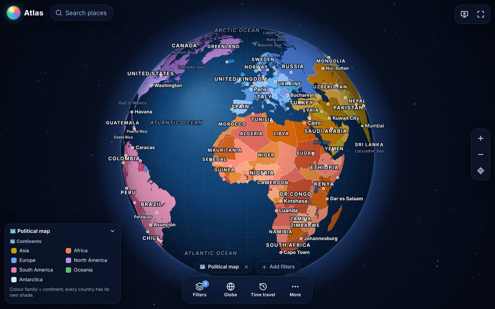
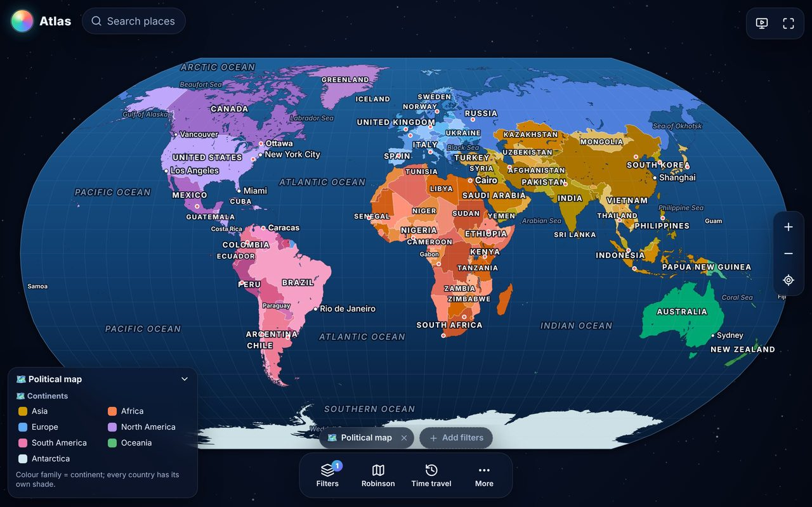
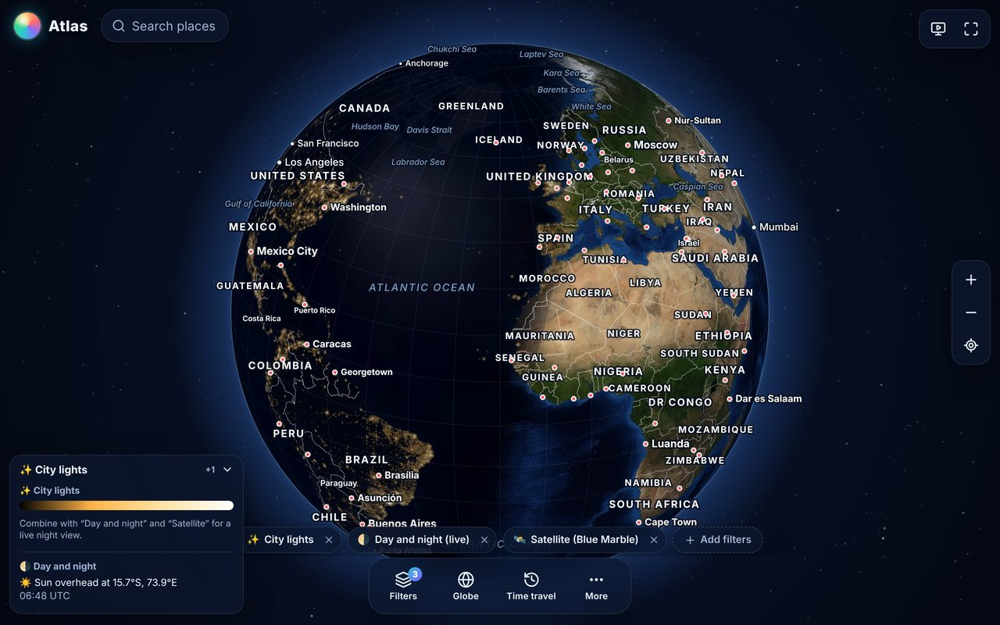
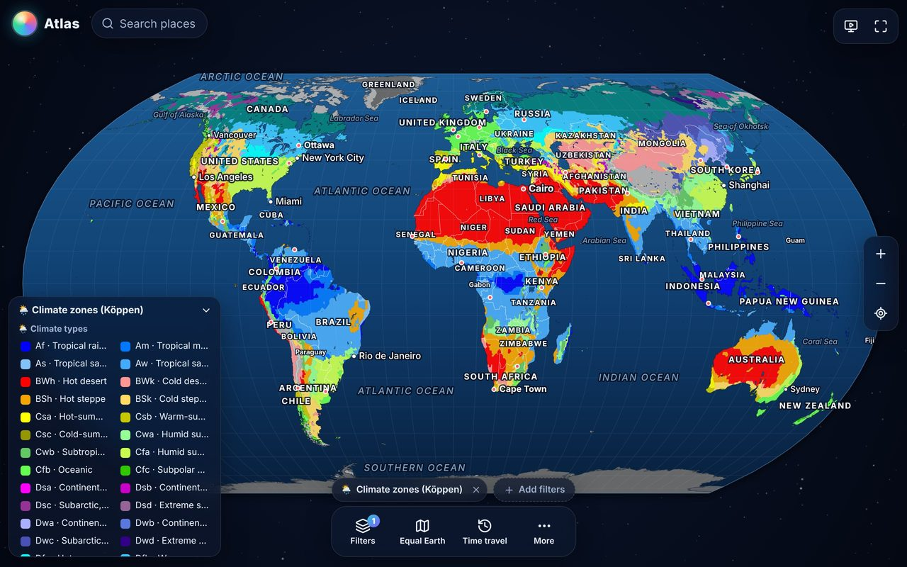
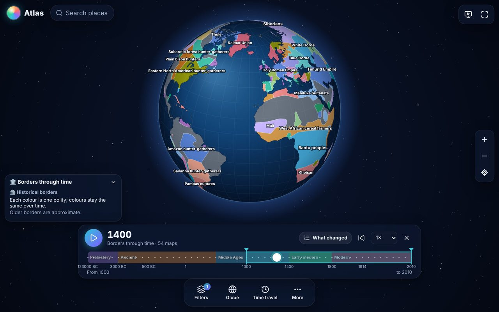
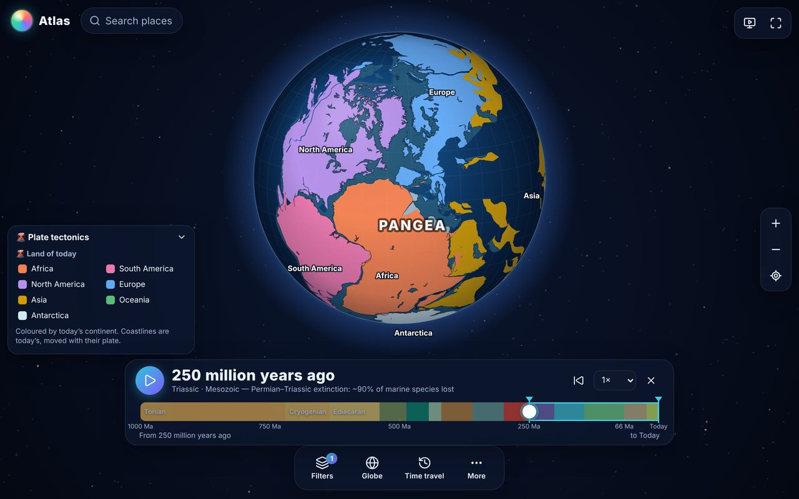
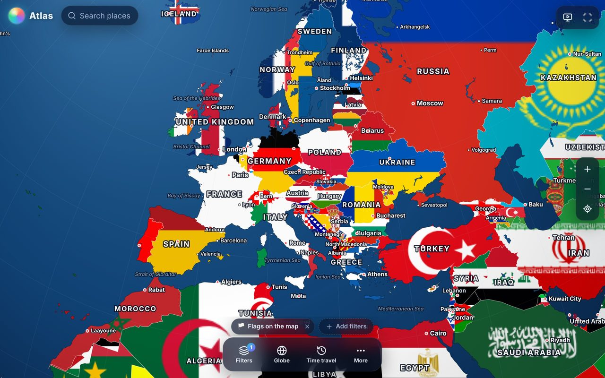
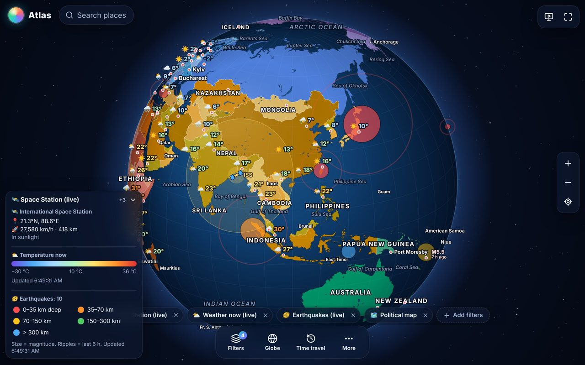

# Atlas Globe

A detailed, colourful, installable world globe (PWA). Stack any of ~140 map filters, morph between 14
projections, travel through 123,000 years of borders and a billion years of plate tectonics, and leave it
spinning full-screen as an ambient display. English and Spanish.

- **App:** https://divaor.github.io/globe/ (GitHub Pages, deployed from `main`)
- **Install:** open it in Chrome, Edge or Safari, then "Install app" / "Add to Home Screen". Works offline after the first visit.

| | |
|---|---|
|  |  |
|  |  |
|  |  |
|  |  |

## What it does

- **Political map (default):** every country has its own shade; the colour family shows its continent.
  Capitals, cities and sea names appear as you zoom. Tap a country for a card with its flag and facts.
- **Navigation:** drag with fling, pinch, mouse wheel, double-tap, keyboard; search any country or city.
- **14 projections, smooth morph:** Globe, Plate Carrée, Mercator, Miller, Robinson, Winkel Tripel, Equal Earth,
  Natural Earth, Mollweide, Gall–Peters, Eckert IV, azimuthal equidistant, Lambert azimuthal, stereographic.
  Every filter (vector and imagery) works in every projection.
- **Filter stack:** turn on several filters, set opacity and order; each has a legend (tap an entry to highlight
  its countries) and values in the country card. Filters include:
  - Political: time zones with live clocks, alliances (EU, NATO, G20, BRICS…), government, independence…
  - People: population, density glow, life expectancy, median age, languages (main / family / branch), religion…
  - Climate & weather: Köppen climate zones, temperature, rainfall, sea temperature, animated winds.
  - Landforms & water: mountain ranges, deserts, plateaus, peaks, rivers and lakes, shaded relief, elevation.
  - Flora & fauna: vegetation zones, forest cover, animal realms with the Wallace Line, 60 iconic animals,
    animated migrations, biodiversity hotspots, national animals and plants.
  - Earth science: tectonic plates by boundary type, volcanoes, animated ocean currents.
  - Economy & energy: GDP, income groups, top producers of 21 resources (oil, lithium, cobalt…), CO₂, renewables…
  - Culture & fun: flags on the map, national colours, driving side, calling codes, Olympic medals and more.
  - Imagery: NASA Blue Marble, yesterday's real satellite view (NASA GIBS), shaded relief, ETOPO.
  - Live: day and night with city lights, earthquakes (USGS), weather now (Open-Meteo), the ISS.
- **Compare two filters:** any two country facts at once. Two numbers make a two-colour map (each in thirds,
  3 × 3 squares to tap) and a scatter chart linked to the globe both ways (tap a dot to fly to its country, tap
  a square to light its countries on the chart), with Spearman's ρ and Pearson's r in plain words, the
  countries furthest from the trend, and a reminder that correlation is not causation. A total against another
  (Olympic medals and population, oil and area…) can be divided ("per million people"). A category against a
  number gives a dot plot with medians; two categories give a cross table with Cramér's V. Start from the
  Filters panel, the More menu, or "Compare with…" in any country-facts filter's legend.
- **Time travel:** borders through time (54 maps, 123,000 BC → 2010) with start/end, play, speed and
  "What changed"; Pangea to today (Merdith et al. 2021 plate model, 1,000 Ma → today) with the geological time scale.
  Researched stories play step by step on the map, with territory, routes, markers and a card with a Wikipedia
  picture for every person, work, place, dish or building:
  - Wars and conquests: 26 conflicts, from Alexander and Rome to the World Wars, with battles and aftermath.
  - Eras and ideas: 11 stories, from classical Athens and the Islamic Golden Age to the Renaissance, the
    Enlightenment, the Industrial Revolution, modern art, rights and freedom, the Space Age and computing.
  - Food through time: 10 stories (the dawn of farming, maize, wheat, rice, the potato, the Columbian Exchange,
    spices, sugar, coffee, tea and chocolate) and 248 dishes of the world, with where and when they were born.
  - Great structures: about 220 structures from Göbekli Tepe to the Burj Khalifa (why, how and by whom), the
    Seven Wonders, the race to the sky, and bridges, canals and dams.
  - Peoples and civilizations: 18 stories and 936 items. The human story from Toumaï, 7 million years ago, to
    Homo erectus, the Neanderthals and Denisovans, Out of Africa, the peopling of the Americas and the
    Austronesian voyages; eleven civilizations (Mesopotamia, Egypt, the Indus, Persia, Kush and Aksum, ancient
    China, the Khmer, Ghana-Mali-Songhai, Great Zimbabwe and the Swahili coast, the Olmecs and Maya, the Andes);
    and 126 civilizations rising and falling in a time tour from 3300 BC to 1600. Dates before 10,000 BC read
    "N years ago".
  - Life through time: 13 stories, 198 steps and 539 fossils, sites, species and finders. A step older than 5
    million years is drawn on the continents of its age (the Merdith et al. 2021 plate model): every fossil moves
    with its plate, the continents drift from one step's age to the next, a tap on old land says what it is
    today, and a fossil's card gives the latitude it lay at. The stories run from the first life and the
    Cambrian explosion, through life coming ashore, the five mass extinctions, the dinosaurs, sea reptiles and
    pterosaurs, the age of mammals and the Ice Age giants, to the fossil hunters, where animals were tamed,
    species lost and saved, and ranges then and now. A time tour in 23 chapters places a catalogue of 136
    famous fossils on the drifting continents, from 3.7 billion years ago to today.
  - Games of the world: 11 stories, 130 steps and 431 items. Every Summer and Winter Olympics (1896–2026) and
    every men's and women's FIFA World Cup (1930–2026) is a step: each country is coloured by how it took part
    (host, champion, medals, took part, boycotted, banned or not invited), arcs fly from every team to the host
    city, and the host's card holds its medal table or last four. A tap on a country tells how its team did, or
    why it stayed away (Kazakhstan in 1980: part of the Soviet Union's team). Also the Women's World Cup from the
    1921 ban, a century of boycotts and bans, the Tour de France and the marathon, from Marathon to the first
    race under two hours.
  - Browse and search every item of a story or a whole collection; shared links open a story at its step.
- **Explore:** measure distances (great circles, flight time), compare two countries, "true size" of countries.
- **Learn & play:** quizzes (find the country, flags, capitals, states and provinces of 48 countries, where in
  the world, when was it built or made, dishes of the world, which era, which civilization, which geologic
  period, who won, guess the link between two country facts), each ending with every answer and its picture;
  guided tours (our planet, eight cities
  through time, history and culture, Out of Africa, capitals of the ancient world, the dinosaur trail, the five
  mass extinctions, Olympic cities, World Cup finals, the Winter Games, great races); "On this day" (Wikipedia).
- **Personal:** visited / want-to-go travel map with stats, notes per country, PNG / 4K / phone wallpaper export.
- **Ambient mode:** full-screen rotating globe with your filters, screen kept awake, clock, optional filter cycling.

## Development

```bash
npm install
npm run dev        # http://localhost:5173
npm run build      # type-check + production build (with service worker) into dist/
```

Browser checks (Playwright, pre-installed in CI images):
`node scripts/test/shot.mjs <url> out.png`, `scripts/test/hero-shots.mjs`, `phone.mjs`, `live-mock.mjs` (live APIs mocked).

## Adding a filter

A filter is one object implementing `LayerDef` (`src/layers/types.ts`). Most data filters are one call:

```ts
import { numericLayer } from './choropleth';
export const myFilter = numericLayer({
  id: 'my-filter', category: 'economy', icon: '📈',
  name: { en: 'My filter', es: 'Mi filtro' }, desc: { en: '…', es: '…' },
  palette: SEQUENTIAL.viridis, scale: 'log',
  values: () => ({ USA: 1, MEX: 2 /* ISO alpha-3 → value */ }),
});
```

Register it in `src/layers/index.ts`, or drop a module in `src/layers/packs/` whose default export registers
filters. Even simpler: add a field to `public/data/attributes/countries.json` (with `label_en`, `label_es`,
`type`…) and it becomes a filter automatically, and one Compare two filters can use (a number with
`"measure": "total"`, such as a production or a count, can also be divided by population, area or GDP).

## Data

All data are pre-built and committed under `public/data/`; the scripts that build them are in `scripts/data/`
(each folder has a README) and every folder has a `SOURCES.md` with sources, licences and attribution.
Main sources: Natural Earth (public domain), NASA Blue Marble and GIBS, NOAA ETOPO1 and ERSST, ECMWF ERA-Interim,
GPCP, Köppen–Geiger (Kottek/Rubel), GeoNames (CC BY 4.0), aourednik/historical-basemaps (GPL-3.0),
Merdith et al. 2021 plate model (CC BY 4.0), PB2002 plates (ODC-By), CIA World Factbook, World Bank,
Our World in Data (CC BY 4.0), mledoze/countries (ODbL), Unicode CLDR, flag-icons (MIT).
The States and provinces quiz uses Natural Earth's admin-1 regions (`scripts/data/build-regions.mjs`; France,
Spain, Italy and the United Kingdom grouped into their regions). The Time travel stories are written from
Wikipedia and the sources listed in each story
(`scripts/data/conflicts/README.md`, `scripts/data/STORIES.md`); item pictures are Wikipedia page images,
loaded from Wikipedia when a card opens, or a Wikimedia Commons file named by the item. Each Games' host,
dates, nations, athletes, medal table or World Cup ranking, and who boycotted or was kept out, are read from
Wikipedia's articles on that Games (`scripts/data/games/README.md`, with the revisions read).

## Licence

Code: GPL-3.0-or-later. Data keep their own licences as listed in the SOURCES files.
