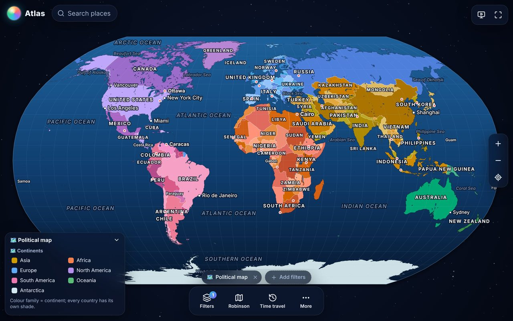
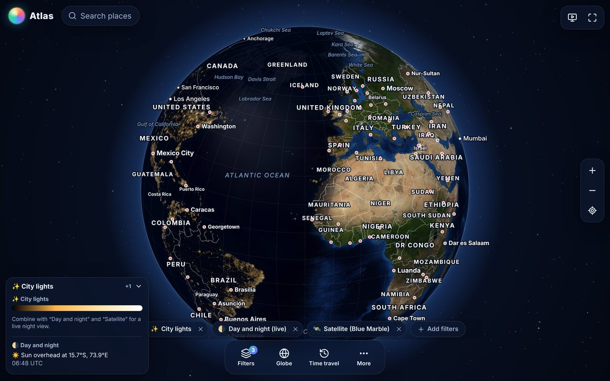
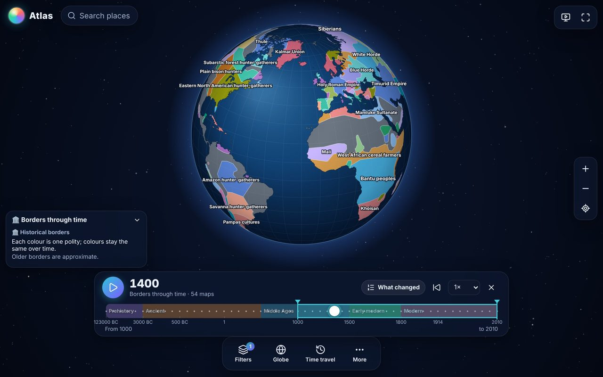
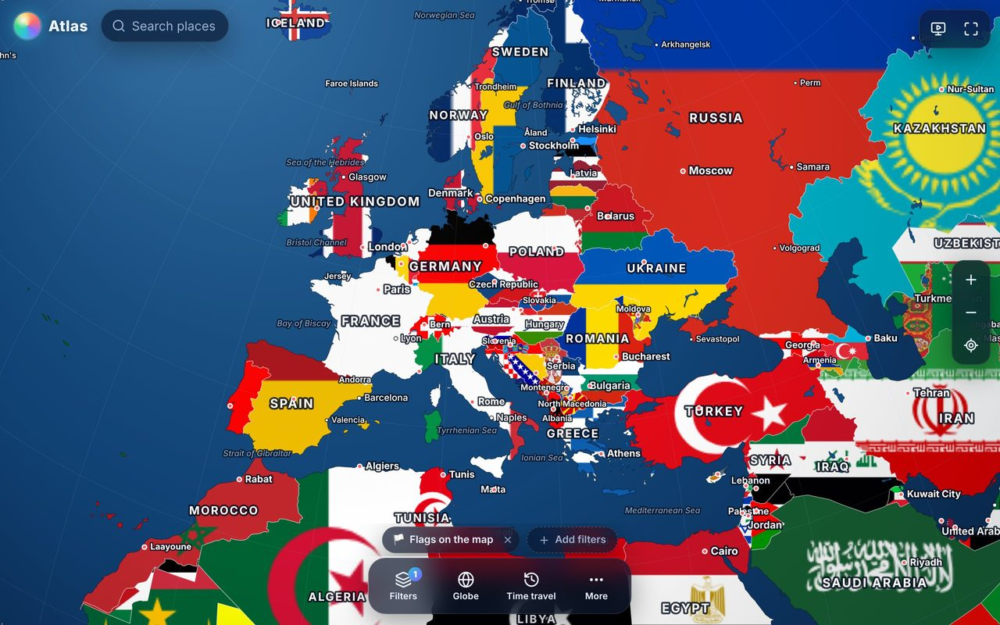
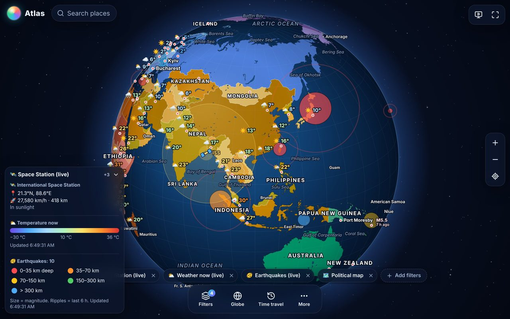

# Atlas Globe

A detailed, colourful, installable world globe (PWA). Stack any of ~140 map filters, morph between 14
projections, travel through 123,000 years of borders and a billion years of plate tectonics, and leave it
spinning full-screen as an ambient display. English and Spanish (Latin America's, or Spain's words).

- **App:** https://divaor.github.io/globe/ (GitHub Pages, deployed from `main`)
- **Install:** open it in Chrome, Edge or Safari, then "Install app" / "Add to Home Screen". Works offline after the first visit.

| | |
|---|---|
|  |  |
|  |  |
|  |  |
|  |  |

## What it does

- **Political map (default):** every country has its own shade; the colour family shows its continent.
  Capitals, cities and sea names appear as you zoom. Tap a country for a card with its flag and facts.
- **Map style and states:** a button by the zoom controls picks the look under every filter: Atlas (a colour per
  country), Map (a plain road-map look without the roads: one light land colour, a light sea, clear borders and more
  cities, their dots and names bigger the more people live there) or Satellite (NASA's Blue Marble, and Sentinel-2
  when you zoom in). States and provinces (the first-level divisions of every country, 4,596 of them) show from
  country zoom with thin dashed lines and their names, on by default and each with its switch; a tap says which one
  ("State: Texas") and Who was born here? names a place's state.
- **Navigation:** drag with fling, pinch, mouse wheel, double-tap, keyboard.
- **Nature (More → Nature):** the animal finder, "Where can I see…?": any animal by its English, Spanish or Latin
  name. The 405 work offline; any other of GBIF's species is looked up live and its range is GBIF's live map of every
  sighting shared. For each, the best parks to see it (ranked by sightings), when to go (sightings by month, live from
  iNaturalist, worldwide or at a park) and Plan a trip (the nearest travel-guide city). What lives here?: tap the map
  or press Near me for the animals people have seen most within 50 km, with photos (live from iNaturalist), or offline
  those of the 405 that live there. The travel guide's See tab adds Wildlife nearby; the quizzes Where does it live?
  (tap where an animal lives) and Who lives here? (which of four animals lives in a place); Pin it adds an Animals pack;
  three tours (The Big Five safari, Animals of the Amazon, Life on the ice); the Naturalist badge (find 25 animals);
  a nature question in the daily challenge; and an Animals of the world playlist for ambient mode.
  Its Plants tab is the plant finder, "Where does it grow?": the 305 plants offline and any other plant on GBIF live,
  each with its best parks and botanical gardens, when it flowers (the sightings people marked in flower on
  iNaturalist, worldwide or near a park) and Plan a trip; What grows here? (the plants seen most within 50 km); the
  green filters; and What's on this month. The travel guide's Facts tab adds nature's calendar nearby; the quizzes
  Where does it grow? (tap where a plant grows wild) and When is it? (the best month for a spectacle); Pin it adds a
  Famous trees pack; two tours (Giants and ancients: the great trees; A year of blossoms); the Botanist badge (find 25
  plants); and a Green planet playlist for ambient mode.
- **Search:** countries, cities, states and provinces, coordinates ("40.4, -3.7"), and what the filters show: the
  people of Who was born here?, museums, masterpieces and their artists, buildings and their architects, World
  Heritage sites, inventions and your own places. The filters that are on come first; a filter that is off is searched
  too, and choosing its result turns it on. Names match in any word order, by the start of each word and with a typo
  or two ("rafa nadal", "Nadal Rafael", "rafael nadl"). A result takes you to its dot: close enough that it stands apart
  from its neighbours, ringed, with its card open. With a filter whose legend lists categories on, its entries are
  found too ("Portuguese" with Languages highlights its countries). An empty box shows your recent searches.
- **14 projections, smooth morph:** Globe, Plate Carrée, Mercator, Miller, Robinson, Winkel Tripel, Equal Earth,
  Natural Earth, Mollweide, Gall–Peters, Eckert IV, azimuthal equidistant, Lambert azimuthal, stereographic.
  Every filter (vector and imagery) works in every projection.
- **Filter stack:** turn on several filters, set opacity and order; each has a legend (tap an entry to highlight
  its countries) and values in the country card. Filters include:
  - Political: time zones with live clocks, alliances (EU, NATO, G20, BRICS…), government, independence…
  - People: population, density glow, life expectancy, median age, languages (main / family / branch), writing
    systems (the script of each country's main language, with a letter of each), religion…
  - Climate & weather: Köppen climate zones, temperature, rainfall, sea temperature, animated winds.
  - Landforms & water: mountain ranges, deserts, plateaus, peaks, rivers and lakes, shaded relief, elevation.
  - Flora & fauna: vegetation zones, forest cover, animal realms with the Wallace Line, 60 iconic animals, great
    migrations through the year (31 journeys by land, sea and air: where each traveller is in every month, with the
    year's key moments), biodiversity hotspots, national animals and plants.
  - Animals of the world: 405 animals covering the globe where they live (379 today and 26 lost since 1500), from
    sightings shared on GBIF. Zoomed out, each part of the world shows its best-known animal that its neighbours
    don't; zoom in for more, with their names. Show all or one group (mammals, birds, reptiles and amphibians, fish
    and sea life, insects and other small creatures), only the threatened (ringed by Red List category) or the Gone
    (the dodo, the thylacine, the passenger pigeon… where they once lived). An animal's card has its picture and call,
    its group and family, its Red List status, size and lifespan where Wikidata has them, the countries it lives in,
    and Show where it lives (its squares, darker where more people saw it, its best parks as numbered stars), Best
    places to see it, Its relatives, and its step of the Lost and saved story.
  - Wildlife parks (2,100 national parks and nature reserves, each with the animals it is one of the best places to
    see) and Zoos and aquariums (1,300).
  - Plants of the world: 305 plants where they grow wild (107 trees, 67 flowers, 45 cacti and succulents, 43
    carnivorous and strange plants, and 43 food plants in their wild homes), from sightings shared on GBIF, as a carpet
    like the animals'. A plant's card has its picture, group and family, Red List status, height and lifespan, the
    countries it grows wild in, when it flowers (live from iNaturalist), and Show where it grows (in green, with its
    best parks and gardens as numbered stars), Best places to see it, Its relatives and, for a crop's wild form, where
    it was first grown.
  - Famous trees (the record holders, checked by hand: the tallest, Hyperion, and the oldest, Methuselah, shown at
    their park because their places are kept secret; and Wikidata's remarkable trees) and Botanical gardens (1,300
    gardens and arboretums, each with the plants that grow wild around it).
  - Ecoregions: RESOLVE's 846 ecoregions coloured by biome, each in its own colour, or by how much of it is protected;
    a tap gives its biome, realm, area and protection and the plants and animals of ours that live in it.
  - The breathing planet: NASA's twelve monthly pictures of how green the land is (MODIS NDVI, 2024), playing as a year
    or one month at a time: spring sweeping north in April and May, and south in October.
  - Nature's calendar: 150 spectacles of plants and animals (cherry blossom, flowering deserts, autumn forests, the
    great herds, the turtles' nesting nights…) by month, the best month marked; What's on this month lists them, the
    nearest to the middle of the map first.
  - Where our food first grew: 57 crops where people first grew them, when, and how they spread around the world
    (arrows to where and when they arrived), each linked to its plant and to its step of the Food stories.
  - Earth science: tectonic plates by boundary type, volcanoes, animated ocean currents.
  - Economy & energy: GDP, income groups, top producers of 21 resources (oil, lithium, cobalt…), CO₂, renewables…
  - Culture & fun: flags on the map, national colours, driving side, calling codes, Olympic medals and more.
  - World Heritage: every site on UNESCO's World Heritage List after the July 2026 session (1,273, plus the 3
    removed), by category or by year listed, with the 58 in danger ringed in red. "Watch the list grow" plays the
    years from the first 12 sites of 1978; a tap on a site opens its picture, Wikipedia's summary, its year,
    criteria and UNESCO's page, and a country's card counts its sites.
  - Where things were invented: the inventions of the Inventions stories where they were made, by age and field.
  - Who was born here?: where 12,215 of the world's best-known people were born (or died), from Wikidata: a dot is a
    place, in the colour of its best-known person's field, bigger for more people; by field (leaders, science,
    writers, art, music, film and stage, sport, thought, explorers) and by when they were born. A tap lists the
    place's people; a person's card has their portrait, years, birth and death places, Wikipedia, their life in
    Lives on the map when there is one, and the city's guide. Living people appear by birthplace only.
  - Close up, the dots of these filters that overlap (two museums in one building, a city's birthplaces) move
    apart, each with a thin line to its true place, so every one can be tapped; the layout holds still while
    you drag the map.
  - Imagery: NASA Blue Marble, yesterday's real satellite view (NASA GIBS), shaded relief, ETOPO.
- **Terrain in detail:** zoomed in, Shaded relief and Elevation are drawn by the GPU from terrain heights
  (Terrain Tiles on AWS: SRTM, GMTED, ETOPO1 and national data), and Satellite from Sentinel-2 cloudless 2016
  (about 10 m), for just the area on screen, sharper the closer you go; the zoom goes about four levels deeper. Tiles
  are kept in memory up to a cap and freed as you move on. In Settings: detail on or off, only on Wi-Fi (where the
  browser says how it is connected), and how much was downloaded. **Save an area for offline use** from the
  filter's legend: choose the detail, see the size first, and find the saved areas in Settings with their size and
  a delete button. **3D terrain** (the mountain button by the zoom buttons): the area on screen as a landscape on
  the curved Earth, draped with satellite, relief or elevation colours, with a slider that raises the mountains;
  drag to turn, pinch to zoom.
  - Live: day and night with city lights, earthquakes (USGS), weather now (Open-Meteo), the ISS.
- **Beyond Earth** (the Space button): the globe becomes another world with its real map: the Moon, Mercury,
  Venus, Mars, Ceres, Vesta, Jupiter and Io, Europa, Ganymede and Callisto, Saturn, Titan and Enceladus, Uranus,
  Neptune and Triton, Pluto and Charon (NASA and USGS mosaics; Solar System Scope for the giant planets). Every
  world shows the IAU names of its places, sized as you zoom; tap one for its card: what it is, its size, and whom
  or what it is named after, in English and Spanish. Every landing on another world is marked, with the rovers'
  and moonwalkers' routes and a card for each mission. The Moon and Mars have a heights map, sharp tiles from NASA's
  Solar System Treks as you zoom in, and the 3D view; other worlds sharpen too where Trek has them. **The solar
  system** shows the Sun, the planets, the dwarf planets and Halley's Comet on their real orbits on any date from
  3000 BC to AD 3000, playing at a day to ten years a second; tap a world for its facts and visit it. Shared links
  open a world (`#world=mars`).
- **Stars, the galaxy and the elements:** behind the globe, the real stars and the Milky Way, lined up for this
  moment and the side of the Earth you face. **The night sky** from any place and time, or from where you are: 5,000
  stars in their colours, the 88 constellations with their figures, borders and names, the Milky Way (ESO's
  panorama), the Sun, the Moon with its phase and the planets, daylight and twilight; drag to look around, play the
  hours, switch to the northern or southern sky, and tap a star, constellation, nebula, cluster, galaxy or planet for
  its card (152 deep-sky objects, the brightest stars, every constellation's story). **Our galaxy**: one zoom from
  the nearest stars through our neighbourhood and the Milky Way seen from above to Andromeda and the Local Group.
  **Where the elements come from**: the periodic table filled with the share of each element made by the Big Bang,
  cosmic rays, dying small stars, exploding massive stars, exploding white dwarfs and merging neutron stars (after
  J. A. Johnson, 2019); an element's card shows where that happens in the sky (with a button back to the element), who mines it today (the resources
  filter, now with 54 mined commodities) and where it was discovered. Search finds constellations, stars, sky objects
  and elements; shared links open them (`#sky=Ori`, `#galaxy=M42`, `#element=Au`).
- **Your data:** a CSV (or a table pasted from a spreadsheet) becomes a filter with a legend, kept on your device
  and nowhere else. Rows can be countries (names in English or Spanish, the usual aliases, or ISO codes), regions
  inside a country (4,596 states, provinces and departments) or places with a latitude and longitude. Numbers are
  read with a decimal point or a decimal comma; a row per place and year (Our World in Data) or a column per year
  (World Bank) gives a year picker and "Play the years"; world and regional totals are set aside. Countries and
  regions are coloured by a number (nine palettes; automatic, even, logarithmic or rank scales) or by categories;
  points are sized by a number and coloured by a category, each with its card. Number columns by country can be
  compared with any country fact. Four samples to try: life expectancy since 1950, Latin America's biggest cities,
  World Heritage sites by Mexican state, and a list of travels.
- **Compare two filters:** any two country facts at once. Two numbers make a two-colour map (each in thirds,
  3 × 3 squares to tap) and a scatter chart linked to the globe both ways (tap a dot to fly to its country, tap
  a square to light its countries on the chart), with Spearman's ρ and Pearson's r in plain words, the
  countries furthest from the trend, and a reminder that correlation is not causation. A total against another
  (Olympic medals and population, oil and area…) can be divided ("per million people"). A category against a
  number gives a dot plot with medians; two categories give a cross table with Cramér's V. Start from the
  Filters panel, the More menu, or "Compare with…" in any country-facts filter's legend.
- **Time travel:** borders through time (54 maps, 123,000 BC → 2010) with start/end, play, speed and
  "What changed"; Pangea to today (Merdith et al. 2021 plate model, 1,000 Ma → today) with the geological time scale.
  Researched stories play step by step on the map, with territory, routes, markers and a card with a Wikipedia
  picture for every person, work, place, dish or building:
  - Wars and conquests: 26 conflicts, from Alexander and Rome to the World Wars, with battles and aftermath.
  - Eras and ideas: 11 stories, from classical Athens and the Islamic Golden Age to the Renaissance, the
    Enlightenment, the Industrial Revolution, modern art, rights and freedom, the Space Age and computing.
  - Food through time: 10 stories (the dawn of farming, maize, wheat, rice, the potato, the Columbian Exchange,
    spices, sugar, coffee, tea and chocolate) and 248 dishes of the world, with where and when they were born.
  - Great structures: about 220 structures from Göbekli Tepe to the Burj Khalifa (why, how and by whom), the
    Seven Wonders, the race to the sky, and bridges, canals and dams.
  - Peoples and civilizations: 18 stories and 936 items. The human story from Toumaï, 7 million years ago, to
    Homo erectus, the Neanderthals and Denisovans, Out of Africa, the peopling of the Americas and the
    Austronesian voyages; eleven civilizations (Mesopotamia, Egypt, the Indus, Persia, Kush and Aksum, ancient
    China, the Khmer, Ghana-Mali-Songhai, Great Zimbabwe and the Swahili coast, the Olmecs and Maya, the Andes);
    and 126 civilizations rising and falling in a time tour from 3300 BC to 1600. Dates before 10,000 BC read
    "N years ago".
  - Life through time: 13 stories, 198 steps and 539 fossils, sites, species and finders. A step older than 5
    million years is drawn on the continents of its age (the Merdith et al. 2021 plate model): every fossil moves
    with its plate, the continents drift from one step's age to the next, a tap on old land says what it is
    today, and a fossil's card gives the latitude it lay at. The stories run from the first life and the
    Cambrian explosion, through life coming ashore, the five mass extinctions, the dinosaurs, sea reptiles and
    pterosaurs, the age of mammals and the Ice Age giants, to the fossil hunters, where animals were tamed,
    species lost and saved, and ranges then and now. A time tour in 23 chapters places a catalogue of 136
    famous fossils on the drifting continents, from 3.7 billion years ago to today.
  - Games of the world: 11 stories, 130 steps and 431 items. Every Summer and Winter Olympics (1896–2026) and
    every men's and women's FIFA World Cup (1930–2026) is a step: each country is coloured by how it took part
    (host, champion, medals, took part, boycotted, banned or not invited), arcs fly from every team to the host
    city, and the host's card holds its medal table or last four. A tap on a country tells how its team did, or
    why it stayed away (Kazakhstan in 1980: part of the Soviet Union's team). Also the Women's World Cup from the
    1921 ban, a century of boycotts and bans, the Tour de France and the marathon, from Marathon to the first
    race under two hours.
  - Journeys and trade routes: 14 stories, 216 steps and 627 items. Each step draws the next stretch of the
    journey, with the traveller (a ship, a caravan, a sledge) moving along it, and the way already travelled
    stays on the map as a faded trail; sea routes are dashed and kept at sea. The journeys of Xuanzang, Marco
    Polo, Ibn Battuta, Zheng He, Magellan and Elcano, Cook, Lewis and Clark, the Arctic explorers and the race to
    the South Pole; the Silk Road, the incense and spice routes, gold and salt across the Sahara, silver and the
    Manila galleons, and the Atlantic slave trade, told plainly with the Slave Voyages numbers and the
    resistance. The peoples met are named, with the guides and interpreters the journeys depended on.
  - Religions and philosophies: 10 stories, 159 steps and 482 items. Where the faiths and schools of thought
    began and how they spread, told plainly and with respect: what believers hold is given as their belief
    ("Muslims believe…", "by tradition"), and debated dates are given as debated. Hinduism, Judaism, Buddhism,
    the first philosophers of Greece, India and China, Confucius, the Dao and the kami, Christianity, Islam,
    Sikhism, and the African faiths carried to the Americas; and a time tour of the world's faiths from Göbekli
    Tepe to today, with today's numbers of believers from the Pew Research Center (2020).
  - Writing and languages: 9 stories, 139 steps and 357 items. The separate inventions of writing in
    Mesopotamia, Egypt, China and Mesoamerica, the alphabet's journey from Egyptian pictures to Unicode, the
    characters of East Asia, scripts made by one person (Hangul, Cherokee, N'Ko…), the code breakers and the
    scripts still unread, the world's language families, the Indo-European languages, the Bantu expansion, and
    Spanish from Latin to the world. 161 cards show a sample in its own script (cuneiform, hieroglyphs,
    Phoenician, Brahmi, Mongolian in columns…), drawn with small font files that are fetched only for the
    letters on screen.
  - Plagues and cures: 11 stories, 177 steps and 498 items. How epidemics spread and how people learned to
    fight them, told plainly: death tolls are given as ranges with their sources, and the people wrongly
    blamed are named as wrongly blamed. The Black Death month by month, plague through the ages, smallpox from
    variolation to eradication, cholera and John Snow, germs and antibiotics, malaria, yellow fever and the
    mosquito, the 1918 flu, HIV and AIDS, COVID-19 (with the debate over its origin as it stands) and vaccines
    for all; and a time tour of medicine from Egypt's papyri to mRNA vaccines, with 103 healers, books,
    hospitals and discoveries.
  - Natural disasters: 9 stories, 144 steps and 352 items. Eruptions, earthquakes, tsunamis, floods and
    storms, and how far their effects reached. Some go hour by hour, in the local time of each place
    ("1 November 1755, 09:40"): Vesuvius in AD 79, the Lisbon earthquake and its tsunami across the Atlantic,
    Krakatoa, the Indian Ocean tsunami of 2004 and the tsunamis that crossed the Pacific, drawn as they
    spread. Also Tambora and the year without a summer, floods, storms and droughts since 1887, and time
    tours of volcanoes and of earthquakes, with today's plate boundaries.
  - Music and dance: 7 stories, 112 steps and 383 items, 90 of them with a short clip of a free recording on
    Wikimedia Commons. Tap play on a card, or turn on ♪ in the story bar to hear each step's clip while the map
    moves, in stories and in tours. A time tour from the Ice Age flutes of the Swabian Jura to streaming, with a
    catalogue of 93 instruments, styles, pieces and musicians; classical music from Bach's Leipzig to the Rite of
    Spring; instruments of the world, each with its own sound; jazz, blues and soul, from Congo Square to
    International Jazz Day; rock, pop and hip hop, from Bombay's film songs to Afrobeats; Latin rhythms; and dances
    of the world, from the Natya Shastra to breaking at the Paris Olympics. Music still under copyright has no clip.
  - Books and writers: 7 stories, 116 steps and 319 items, 105 of them with a famous line in its own language and
    script (Homer's Greek, Murasaki's Japanese, Ferdowsi's Persian…), with how it reads and what it means. A time
    tour from Gilgamesh to e-books with a catalogue of 96 books, writers and libraries; epics of the world; tales
    that travel, from the Panchatantra to Pinocchio; novels at the places where they happen; poetry of the world;
    literature in Spanish, from the jarchas to today; and the story of the book, from clay tablets to screens.
    Long quotes come only from texts in the public domain; books still under copyright get one short line.
  - Art of the world: 7 stories, 113 steps and 341 items. Each work sits where it was made, its card shows the work
    itself (to open full screen and zoom) and where it is now. A time tour from the ochre of Blombos Cave to street
    art with a catalogue of 109 works, artists and museums; cave and rock art; the ancient world; Renaissance and
    Baroque painting; art of Asia; Impressionism to modern art; and works taken in war and by empires, and
    returned, with each side's case. Works still under copyright have no picture.
  - Inventions: 10 stories, 163 steps and 539 items. Where things were invented and how they travelled: a time
    tour from the stone tools of Lomekwi, 3.3 million years ago, to generative AI, with a catalogue of 113
    inventions; China's four great inventions and their journeys west; keeping time, from shadow clocks to the end
    of the leap second; lenses, from Ibn al-Haytham to the Webb telescope; flight, from kites to drones; messages,
    from Inca runners to undersea cables; power, from water wheels to solar panels; everyday inventions; who really
    invented it, with the disputed firsts and forgotten inventors; and inventions from Latin America.
  - World Heritage: 4 stories, 61 steps and 170 items. How World Heritage began with the rescue of Abu Simbel;
    sites destroyed and rebuilt, from Warsaw to Mosul; saving nature's wonders; and Latin America's history told
    through its World Heritage. Any story card for a World Heritage site says when it was listed and whether it is
    in danger, with a link to UNESCO.
  - Space exploration: 5 stories, 90 steps and 337 items, on the Earth and on the worlds they reached (a step on
    the Moon or Mars turns the globe into that world, with its landings and rover drives). Astronomy through
    history, from Nabta Playa and Babylon's diaries to Mauna Kea and the Atacama; the space race, from the V-2 to
    Apollo–Soyuz; footprints on the Moon, every landing from Luna 2 to Artemis II; robots to the planets, from
    Mariner 2 to Juno; and wheels on Mars, from Mars 3 to where Curiosity and Perseverance are now.
  - Lives on the map: 168 lives of scientists, writers, artists, composers from Monteverdi to Bowie, leaders, campaigners
    and athletes, from Hatshepsut and Confucius to Kobe Bryant, followed place by place: where they were born, studied, worked,
    made their great works, were exiled or imprisoned, and died, each step with their age, the route from the last
    place (by sea, by air, on foot) and the borders of that year. Only the places that mattered, not every stop of
    a tour; where historians are not sure of a place or a date the step says so. The last step shows the places
    you can visit today (birth houses, museums, graves). Twelve pairs of lives side by side (Chopin and Liszt, Pelé and
    Maradona, Darwin and Lincoln, born the same day…) in two colours, with a handshake where their paths crossed. A city's guide has a People tab (the
    lives that pass through it, who was born and who died there), search finds every life, and On this day has
    their births and deaths. Lives are written only for people who have died.
  - Browse and search every item of a story or a whole collection; shared links open a story at its step.
- **Explore:** measure distances (great circles, flight time), compare two countries, "true size" of countries.
- **Learn & play:** quizzes (find the country, flags, capitals, states and provinces of 48 countries, where in
  the world, when was it built or made, dishes of the world, which era, which civilization, which geologic
  period, who won, guess the link between two country facts, which journey, which faith, which script, which
  language family, which epidemic, which disaster, what are you hearing, which book is it from, who made it, which World Heritage site, who invented it,
  which world is this, who landed here, which constellation, where was this element made, which country in between),
  each ending with every answer and its picture; two games of time:
  Put them in order (four things from the stories, oldest first, then shown in order with their dates and pins on the
  map) and Time detective (a map of old borders with no names: which of four years is it from?); a daily challenge
  of eight questions, the same for everyone each day, with a streak and a result to share; your progress, with right
  answers, day streaks and badges for six subjects, the daily challenge and the tours (kept in this browser);
  guided tours (our planet, twenty cities through time, from Athens, Baghdad and Xi'an to Buenos Aires, Rio de
  Janeiro and Cusco, history and culture, Out of Africa, capitals of the ancient world, the dinosaur trail, the five
  mass extinctions, Olympic cities, World Cup finals, the Winter Games, great races, along the Silk Road, around
  the world under sail, to the ends of the Earth, gold, silver and spices, holy places, pilgrims' ways, writing
  is born, code breakers, the story of the alphabet, languages of the world, pandemics that changed history,
  medicine's great discoveries, tsunamis across the oceans, the year without a summer, disasters of the Ring of Fire, first lines,
  great libraries, masterpieces and where they are, sounds of the world, cities of music, Latin America's World
  Heritage, nature's wonders, lost and rebuilt, China's great inventions, from the telegraph to the Web, invented in
  Latin America, a grand tour of the solar system, footprints on the Moon, born in the stars, a night under the
  Southern sky); "On this day", any day of the year: what the Time travel stories tell of it, each opening its
  step, and Wikipedia's selection of events, linked to the story that tells the same event.
- **Map games** (More → Map games): twelve games played on the map, each with a new puzzle every day that is the
  same for everyone (the panel's Today list), a best score and badges. The map, its labels and filters come back as
  they were when a game ends.
  - **Pin it:** drop a pin where a place is, five rounds. A pin on the spot scores 5,000; 1,500 km off scores about
    1,840. Seven packs of places from the app's own data: capitals, World Heritage sites, great structures, battles,
    dishes, inventions and museums, or all of them mixed. Hard mode hides every name, even the seas'.
  - **Higher or lower:** which of two countries has more people, more forest, more coastline…? Twenty facts, the
    answer shown on the map as that fact's filter. The run goes on until the first wrong answer.
  - **Grand tour:** visit six cities in the shortest way you can find. By air (the shortest flight), by land (the
    fewest borders crossed, then the shortest), or a historical journey whose stops are the story's own places
    (Marco Polo, Ibn Battuta…). Scored against the best order, found by the app.
  - **Name them all:** every country of a continent, every capital, or every neighbour of a country, typed against
    the clock (ten seconds each). English and Spanish names both count.
  - **Border chain:** from a country, a neighbour, then its neighbour, never the same one twice, in 90 seconds.
    Crossing into another continent earns a bonus; a dead end stops the chain.
  - **Outline:** a country's shape, alone. Each wrong guess shows its neighbours around it (or, for an island, its
    continent and first letter). Hard mode turns the shape.
  - **Museum hop:** five of the world's best-known paintings and sculptures, each in another museum; see them all
    from the first one with the least travel (the Grand tour's best order, on the art guide).
  - **Climate detective:** a city's year of weather, its temperature and rain month by month (the travel guide's
    climate normals); pin where it is. A bonus for a pin in the city's own climate zone (the Köppen filter's zones).
  - **Explorer's log:** follow Ibn Battuta, Magellan and Elcano, Cook, Lewis and Clark, Humboldt or Darwin by pinning
    each next stop of the journey; the story's step is told after each pin.
  - **Sunrise race:** where is the sun rising right now? Setting? Where is it noon, or midnight, and where is the sun
    straight overhead? Scored by the distance to the line, with day and night drawn after each pin.
  - **Whose life is this?:** a life's places appear one at a time with their years; pick the person among four. Fewer
    places, more points.
  - Badges for each, Cartographer for three stars in every game, and around the app: Curator (50 masterpieces
    opened), Biographer (10 lives followed to the end) and a travel guide trip across three continents.
  - **Border hop**, getting from one country to a far one across land borders by tapping the countries on the map,
    their names hidden.
  - **Goals:** the same pair plays differently with each one. Fewest countries, fewest people, smallest area, or
    the shortest distance from capital to capital. Spain → China is 4 countries in between at the fewest (France,
    Germany, Poland, Russia), but 6 when the fewest people (272 million) is the goal, through Switzerland,
    Austria and Slovakia.
  - **Knowledge rounds:** only some countries may be crossed. Only Spanish-, Arabic-, French- or Russian-speaking
    countries, only those that drive on the left, only Olympic hosts, or none in NATO or the EU. A refused tap says
    why ("Brazil is not a Spanish-speaking country").
  - **Modes:** practice by level and continent, a daily route that is the same for everyone, Blitz (five routes
    against the clock) and challenge links that let a friend play the same round (`#hop=ESP-CHN&goal=people&beat=870`).
  - **Scoring, one system for all map games:** the app knows the best route (par). A route scores 1,000 × par ÷
    yours. ★★★ matches par; ★★ is one country more, or within 15 %.
  - **Hints** cost points and stars. Names (−150) and the goal's map (−200) leave at most ★★; each next step (−300)
    leaves ★.
  - **After a round:** the best route for each goal, and notes on the odd borders crossed: Kaliningrad, Nakhchivan,
    Cabinda, the Channel Tunnel…
  - **Progress:** bests, the daily-route streak and badges in your progress panel: six for Border hop, one for each
    other game (a pin within 25 km, a run of ten, a tour at par, a whole list named, a chain of fifteen, five shapes
    at the first try) and one for playing all seven.
  - **In the quiz:** "Which country in between?" (two countries that do not touch, and the one country you cross)
    is a quiz of its own and one of the daily challenge's eight questions.
- **Travel guide** (More → Travel guide): pick the cities you want to visit (690: every capital, every city of a
  million people or more, and towns rich in sights such as Cusco, Luxor or Kraków) by searching, by tapping their dot
  on the map, with Plan a trip on a country's card, or from your Want to go list. Each city's guide has:
  - **Eat:** the city's dishes, then the rest of the country's and nearby countries', each opening its story in Food
    through time; the national dish; what was first grown nearby; and Wikivoyage's "Eat" overview, read live and
    credited.
  - **See:** World Heritage sites in the city and a day trip away, great structures, and the city's guided tour.
  - **Museums:** the best known within a few km of the centre (from Wikidata), by kind, with visitors a year where
    known.
  - **Facts:** languages, money, plugs and voltage, the driving side, the calling code, the time there against yours,
    today's sunrise and sunset, and the weather month by month with the best months to go.
  - **History here:** what the Time travel stories tell of the place, each opening its story at that step.
  - **Read more:** the city's Wikivoyage and Wikipedia pages.

  **The trip** is drawn on the map in order, with the distance and flight time of each leg and a Best order button.
  It is kept on this device, shared as a link (`#trip=lima,cuzco,la-paz`; `#guide=kyoto` opens one city) and prints
  as a page. Not in the guide: hotels, restaurants by name, prices, visas and safety advice, which change too often to
  keep right.
- **Art and architecture** (More → Art and architecture): which masterpieces and buildings you can see in which city.
  - **Masterpieces where they are now:** for 182 museums, their best-known works (2,226, ranked by how many
    Wikipedias write about them), with a picture, the artist and the date; each picture shows its licence and author,
    read live from Wikimedia Commons.
  - **The city's art guide** (the travel guide's Art tab): "In Madrid you can see 110 of the world's best-known
    works", museum by museum, filtered by painting, sculpture, antiquities or other treasures, by period and by artist.
  - **Buildings** (the guide's Buildings tab): a city's notable buildings with their architects, by style.
  - **Artist and architect trails:** every museum that holds an artist's best-known works (Van Gogh, 56 works in 21
    museums), or every building of an architect (Gaudí's twelve), on the map, and Plan a trip turns the trail into a
    trip in the travel guide.
  - **Map filters:** art museums (sized by visitors a year), masterpieces (where they hang, by kind and period) and
    architectural styles (4,877 buildings, 2,763 of them with a style, from Gothic to Art Nouveau and today's towers).
  - **Now in:** the art items of the Time travel stories say where each work is today ("Now in: Louvre Museum,
    Paris"), with a link to that city's art guide.
  - **Play:** the quiz "Which museum is it in?" and a masterpieces pack in Pin it.
- **Personal:** visited / want-to-go travel map with stats, notes per country, PNG / 4K / phone wallpaper export.
- **Read aloud:** guided tours and the Time travel stories read by your device's own voices, in English or Latin
  American Spanish (a Mexican or other Latin American voice before Spain's); the sentence being read is marked, the
  next stop or step waits for the voice, and music turns down while it reads. Choose the voice and speed in Settings.
  A guided tour that stops at a story shows one set of controls (the tour's play, back and next); the story's own
  come back when the tour ends.
- **Two Spanishes:** Settings → Language offers English, Español (Latinoamérica) and Español (España). The texts are
  written once in Latin American Spanish; Spain's Spanish shows them with the words used in Spain (ordenador, patata,
  zumo, móvil, coche, vídeo, judías, gafas, añadir, penalti, prórroga, piso, quotations with vosotros…), on the page,
  on the map's labels and when read aloud (by a voice from Spain first). The rules (`src/app/spain.ts`) were written
  for the phrases the app uses and keep words that mean something else here (the Pope, "Maní" the town, "departamento"
  as a region, the human "computadoras" of Harvard and NASA). `npm run test:spain` applies them to all 52,616 Spanish
  texts, checks agreement ("el primer ordenador electrónico", "judías negras") and, with `--list`, prints every
  change for review. A share link carries the choice (`lang=es-ES`).
- **Ambient mode:** full-screen rotating globe, screen kept awake, clock. Show the filters on your map, or a
  screensaver playlist: Our planet, Night and day, Restless Earth, Water and weather, Life on Earth, People and
  cultures, or Around Latin America, each view with its title and a line about it, read aloud if you like; or make
  your own playlist from views of the map (filters and place) and share it as a link.

## Development

```bash
npm install
npm run dev        # http://localhost:5173
npm run build      # type-check + production build (with service worker) into dist/
```

Browser checks (Playwright, pre-installed in CI images):
`node scripts/test/shot.mjs <url> out.png`, `scripts/test/hero-shots.mjs`, `phone.mjs`, `live-mock.mjs` (live APIs mocked).

## Adding a filter

A filter is one object implementing `LayerDef` (`src/layers/types.ts`). Most data filters are one call:

```ts
import { numericLayer } from './choropleth';
export const myFilter = numericLayer({
  id: 'my-filter', category: 'economy', icon: '📈',
  name: { en: 'My filter', es: 'Mi filtro' }, desc: { en: '…', es: '…' },
  palette: SEQUENTIAL.viridis, scale: 'log',
  values: () => ({ USA: 1, MEX: 2 /* ISO alpha-3 → value */ }),
});
```

Register it in `src/layers/index.ts`, or drop a module in `src/layers/packs/` whose default export registers
filters. Even simpler: add a field to `public/data/attributes/countries.json` (with `label_en`, `label_es`,
`type`…) and it becomes a filter automatically, and one Compare two filters can use (a number with
`"measure": "total"`, such as a production or a count, can also be divided by population, area or GDP).

## Data

All data are pre-built and committed under `public/data/`; the scripts that build them are in `scripts/data/`
(each folder has a README) and every folder has a `SOURCES.md` with sources, licences and attribution.
Main sources: Natural Earth (public domain), NASA Blue Marble and GIBS, NOAA ETOPO1 and ERSST, ECMWF ERA-Interim,
GPCP, Köppen–Geiger (Kottek/Rubel), GeoNames (CC BY 4.0), aourednik/historical-basemaps (GPL-3.0),
Merdith et al. 2021 plate model (CC BY 4.0), PB2002 plates (ODC-By), CIA World Factbook, World Bank,
Our World in Data (CC BY 4.0), mledoze/countries (ODbL), Unicode CLDR, flag-icons (MIT).
Time detective measures, for nine regions, which polities hold each borders map's land and how different two years
look there (`scripts/data/history/detective.mjs`, `public/data/history/detective.json`); On this day lists the
stories' dated steps and items by day (`scripts/data/build-onthisday.mjs`, `public/data/onthisday/`); and
`scripts/test/tours.mjs` checks that every tour stop opens a story step that exists.

**The travel guide** (`scripts/data/guide/build-guide.mjs` builds `public/data/guide/`): its 690 cities are the
app's own, each with its Wikidata id from Natural Earth's populated places; what to eat, see and what the stories
tell come from the app's collections; museums near each city and its Wikivoyage and Wikipedia page names come from
Wikidata (CC0); the weather is CRU CL 2.0's monthly normals for 1961–1990 (University of East Anglia, New et al. 2002).
Wikivoyage's text is read live in the browser and credited, not stored in the app.

**Art and architecture** (`scripts/data/artguide/build-artguide.mjs` builds `public/data/artguide/`): every museum
near the travel guide's cities with articles in 20 Wikipedias or more, with its works now in its collection or a part
of it (the Louvre's Department of Paintings), keeping those with three works or more; notable buildings that name
their architect (or, without one, a style); and where our art items are now. All from Wikidata (CC0), fetched once and
kept in `scripts/data/artguide/`; pictures are Wikimedia Commons files, loaded by the browser with their licences.

**Lives on the map** (`scripts/data/lives/`, one file per person in the format of `scripts/data/lives/README.md`,
built by `scripts/data/build-conflicts.mjs --kind lives`): written from Wikipedia and the sources each life lists,
checked against Wikidata's dates and places (the build warns where they differ) and against the GeoNames gazetteer
(CC BY 4.0) for the coordinates. **Who was born here?** (`scripts/data/born/build-born.mjs` builds
`public/data/born/`): people with articles in 48 Wikipedias or more, with their places of birth and death, from
Wikidata (CC0) through the QLever SPARQL service of the University of Freiburg; people known for a crime are left
out. Portraits are read live from Wikidata and Wikimedia Commons, with their licences.

**Wild world** (`scripts/data/wild/`: `fetch-wild.mjs` asks once and keeps the answers in `.cache/wild`;
`build-wild.mjs` builds `public/data/wild/` with no network). The animals: species on Wikidata (CC0, through QLever)
with a conservation status, chosen by how many Wikipedias have an article, by group and with no continent holding
more than 22% of a group, plus a hand list of each region's best known and of the animals lost since 1500
(`choose.mjs`); every name checked by hand in English and Latin American Spanish (`names.json`). Where each lives:
GBIF's ad hoc map tiles, counting only sightings shared under CC0 or CC BY (never CC BY-NC), without zoo animals or
fossils, since 1970, in GBIF's squares of 1.40625° (about 150 km, never finer); lone squares with one or two sightings
are dropped, as is a lone square holding a zoo or an aquarium (unless it has a quarter of the animal's busiest
square's sightings), animals carried around the world keep only their native continents, a continent with under 2% of a
land animal's sightings is taken as zoos and escapes, and dogs are taken away from wolves and house pigs from wild
boars, square by square. The gone animals' last ranges are drawn by hand from historical records. Parks, reserves,
zoos and aquariums come from Wikidata; an animal's best parks are those in its squares with the most sightings.
Pictures and calls are Wikimedia Commons files, loaded by the browser with their licences. The 31 migrations
(`migrations.json`) were researched from papers, tracking studies and park services, with their sources.

**Green planet** (`scripts/data/green/`: `fetch-green.mjs` asks once and keeps the answers in `.cache/green`;
`build-green.mjs` builds `public/data/green/` with no network). The plants: a hand list of 305 plants in five groups
(`names.json`, every name checked by hand in English and Latin American Spanish), found on Wikidata (CC0, through
QLever) and matched to GBIF's taxonomy. Where each grows: GBIF's ad hoc map tiles as for the animals (CC0 and CC BY
sightings, no living specimens of gardens, no fossils, since 1970, in squares of 1.40625°); lone squares are dropped,
as is a lone square holding a botanical garden, plants planted far from home keep only their native continents
(`choose-green.mjs`), and a continent with under 5% of a plant's sightings is taken as gardens and escapes. A plant's best places are the parks (Wild world's) and botanical
gardens in its squares with the most sightings. Botanical gardens, arboretums and remarkable trees (with their species,
"individual of taxon") come from Wikidata; the record trees were checked by hand with their sources (`trees.json`).
Ecoregions: RESOLVE Ecoregions 2017 (Dinerstein et al., CC BY 4.0), simplified with mapshaper (`fetch-green.mjs eco`),
with Spanish names from Wikidata's ecoregions where they exist. The breathing planet: NASA's MODIS Terra monthly NDVI
for 2024 from GIBS (public domain), as twelve WebP pictures (`fetch-green.mjs ndvi`). Nature's calendar
(`calendar-plants.json`, `calendar-animals.json`) and the first crops (`crops.json`) were researched from park
services, tourism boards, archaeobotany papers and FAO, each with its sources. When a plant flowers is read live from
iNaturalist (sightings annotated as flowering).

**The map games' borders** (`scripts/data/play/build-borders.mjs` builds `public/data/play/borders.json`) come from
the app's own 1:50m map, so a route on screen is a route in the game. Two countries are neighbours when their outlines
share an edge (323 land borders).
- **Hand-sorted borders** (`scripts/data/play/border-rules.json`):
  - exclaves on the same continent count (Kaliningrad, Nakhchivan, Cabinda, Dubrovnik, Gaza, Northern Ireland, East Thrace);
  - overseas regions on another continent (French Guiana, Ceuta and Melilla) count only when turned on;
  - the Channel Tunnel, the Øresund Bridge, the King Fahd Causeway and the Johor–Singapore Causeway count; ferries do not.
- **Checks against two other lists**, the CIA World Factbook's neighbours and Wikidata's "shares border with" (P47,
  CC0, cached in `wikidata-p47.json`); each difference is reviewed in the rules file (Siachen Glacier left out,
  Botswana–Zambia at Kazungula added, India–Sri Lanka a sea border only).
- **The groups for knowledge rounds:** languages, driving side and NATO and EU membership come from the country facts.
  Olympic hosts come from the Games of the world data.
- **Tests:** `npm run test:play` checks routes and par, the odd borders, every knowledge round and level, the daily
  route, scoring and challenge links.
The states and provinces drawn on the map, their names (with Spanish names) and the one a tap or a born-here place is
in come from Natural Earth's 1:10m admin-1 regions (public domain, `public/data/base/admin1.json`, loaded the first
time they are shown). The States and provinces quiz uses Natural Earth's admin-1 regions (`scripts/data/build-regions.mjs`; France,
Spain, Italy and the United Kingdom grouped into their regions). The Time travel stories are written from
Wikipedia and the sources listed in each story
(`scripts/data/conflicts/README.md`, `scripts/data/STORIES.md`); item pictures are Wikipedia page images,
loaded from Wikipedia when a card opens, or a Wikimedia Commons file named by the item. Each Games' host,
dates, nations, athletes, medal table or World Cup ranking, and who boycotted or was kept out, are read from
Wikipedia's articles on that Games (`scripts/data/games/README.md`, with the revisions read). The Journeys and
trade routes stories are written from the Wikipedia articles listed in each story; the numbers of the Atlantic
slave trade are those of the Trans-Atlantic Slave Trade Database (SlaveVoyages), as Wikipedia reports them. The Religions and
philosophies and Writing and languages stories are written from the Wikipedia articles listed in each story.
So are the Plagues and cures and Natural disasters stories, with figures from the WHO, UNAIDS and NOAA where
the stories say so; the tsunami fronts are computed from NOAA's seafloor depths and checked against the
arrival times that tide gauges recorded.
The Music and dance, Books and writers and Art of the world stories are written from the Wikipedia articles listed
in each story. Their clips are free recordings on Wikimedia Commons (public domain or Creative Commons, each credited
with its licence and a link to its page), streamed from Commons by the reader's browser only when played; quotes in
other languages come from Wikisource and the articles, translated plainly where no public-domain translation exists.
The Inventions and World Heritage stories are written from the Wikipedia articles listed in each story. The World
Heritage List (`public/data/layers/heritage.json`, made by `scripts/data/world-heritage/build.py`) comes from
Wikipedia's lists of World Heritage Sites by year of inscription and in danger, with places, pictures and articles
from Wikidata (CC0) and Spanish names from Spanish Wikipedia's lists by country; it also gives the country fact
"UNESCO World Heritage Sites".
The other worlds' maps, place names and heights come from NASA (Solar System Treks, LRO, MESSENGER, Magellan,
Viking, MGS, Galileo, Voyager, Cassini, Dawn, New Horizons), the USGS Astrogeology Science Center and the IAU
Gazetteer of Planetary Nomenclature, with Solar System Scope's textures (CC BY 4.0) for the giant planets
(`scripts/data/space/`, `public/data/worlds/SOURCES.md`); the landings, the worlds' facts and the Space exploration
stories are written from NASA, ESA, CNSA, ISRO, JAXA and the missions' pages, LROC and Wikipedia, as listed in each.
The solar system view uses JPL's approximate planet positions (Standish) and its Small-Body Database.
The sky's stars, constellation figures, borders and names come from d3-celestial (BSD; XHIP, the IAU, Davenhall &
Leggett's boundaries), the Milky Way from ESO's panorama (ESO/S. Brunier, CC BY 4.0) and, seen from above, from an
artist's impression (NASA/JPL-Caltech/ESO/R. Hurt); the constellations', stars', deep-sky objects' and elements'
cards are written from Wikipedia, NASA, ESA, ESO and the papers listed in each, the elements' origins after Johnson
(2019), and the mining figures are the USGS Mineral Commodity Summaries 2026 (`scripts/data/sky/`,
`public/data/sky/SOURCES.md`).
The samples for "Your data" are Our World in Data's life expectancy (CC BY 4.0) and tables made from the app's own
cities and World Heritage list (`scripts/data/samples/`, `public/data/samples/SOURCES.md`).
The script samples use subsets of the Noto fonts (SIL Open Font License 1.1) and, for rare Chinese characters,
Jigmo (CC0), made by `scripts/data/build-fonts.mjs` (`public/data/fonts/`, with the licence in `OFL.txt`).

## Licence

Code: GPL-3.0-or-later. Data keep their own licences as listed in the SOURCES files.
